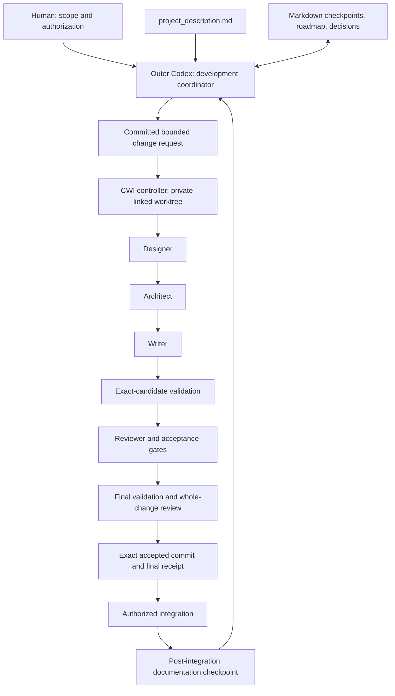

# Development architecture and operating plan

## 1. Goal

Build the research workbench specified in [project_description.md](project_description.md) through a series of bounded, verifiable coding-pipeline runs. Make every restart intelligible to a human or a fresh Codex session: what is implemented, what is accepted, what is integrated, what is blocked, and what the next safe action is.

This document governs **software development**, not the scientific claim graph that the eventual product will maintain. The product remains agnostic to the particular scientific tools supplied by a user.

## 2. Recommended architecture



The outer coordinator does not become a second implementation engine. It translates the long project description into successive change requests, invokes CWI, and reconciles evidence. CWI owns implementation Git operations, validation, repair, and acceptance within each run. Its Writer is the authorized implementer.

Three alternatives were considered. A single huge CWI request makes phase boundaries, context limits, and stopping decisions difficult. Hand-written product changes by the outer agent would bypass the chosen implementation method. A thin outer coordinator with small CWI runs preserves both continuity and the existing backend's acceptance controls; this is the proposed approach.

## 3. Repository layout

```text
research-pipeline/
├── README.md                       # Human entry point
├── project_description.md          # Existing product specification; preserved
├── AGENTS.md                       # Outer/delegated execution-mode rules
├── DEVELOPMENT.md                  # This operating design
├── ROADMAP.md                      # Ordered development outcomes and dependencies
├── STATUS.md                       # Last committed checkpoint + one next action
├── BACKLOG.md                      # Deliberately deferred, blocked, or paused items
├── DECISIONS.md                    # Consequential decision index
├── CHANGELOG.md                    # Accepted and integrated development history
├── development/
│   ├── README.md
│   ├── RUNBOOK.md                  # Installation, start, inspect, integrate, resume
│   ├── BOOTSTRAP.md                # Safe first run from Markdown-only source
│   ├── CODEX_START.md              # Initial and continuation prompts
│   ├── REQUIREMENTS.md             # Exact specification-to-evidence mapping
│   ├── ENVIRONMENT.md              # Non-secret version/launch contract
│   ├── PIPELINE_REVIEW.md          # Findings about the supplied backend snapshot
│   ├── phases/                    # One outcome/acceptance plan per development phase
│   ├── requests/                  # Committed bounded requests; revision history
│   ├── runs/                      # Human-readable run/evidence summaries
│   ├── decisions/                 # Detailed decision records
│   ├── review/                    # Supplied-backend inventory and test results
│   └── templates/                 # Reusable Markdown record formats
├── implementation/
│   ├── README.md
│   ├── pyproject.toml             # Created by CWI, not supplied by this kit
│   ├── src/research_pipeline/     # Created by CWI
│   ├── tests/                     # Created by CWI
│   └── scripts/                   # Validation and developer utilities, created by CWI
├── docs/                          # Product architecture and usage documentation
├── examples/                      # Curated, non-private demonstration material
├── local/                         # Ignored live notes, raw reports, local scratch
│   └── README.md                  # The one tracked navigation note in this area
├── coding_pipeline/               # Separate untracked Git clone; exact directory name
├── workflow_logs/                 # CWI-owned ignored diagnostics
└── .git/                          # Git administration
```

Only existing Markdown placeholders are included in this kit. The non-Markdown implementation paths above are future outputs of CWI.

### Root-file rule

Do not put `pyproject.toml`, a lockfile, `.gitignore`, a shell script, or a database at the root. Keep these under an appropriate subdirectory. Do not use root symlinks as a loophole.

Git creates a `.git` **file** in linked worktrees. The root-layout validator must recognize that administrative exception; otherwise every CWI candidate would fail for a file Git itself requires. A `.github/` or `.obsidian/` directory is compatible with the root rule, although creating CI or plugin configuration is a separate, deliberate change.

### Three different workspaces

1. The **original checkout** contains development documentation and receives integrated product code.
2. The **CWI linked worktree** contains the exact candidate under construction. It does not contain ignored local clones or dependency directories by default.
3. A **research project vault**, created later by the product, contains scientific claims, notes, papers, derivations, and evidence. Keep live private vaults outside the source repository or under ignored `local/` storage; keep only deliberate fixtures/examples in Git.

CWI's authoritative state is a fourth storage location controlled by CWI, not by this layout. Its Linux account-state path is fixed; see the runbook. Do not relocate or rewrite it to make the development repository look self-contained.

## 4. Information ownership: avoid competing status files

| Information | Authoritative record | Convenient view |
| --- | --- | --- |
| Product requirements | `project_description.md` and explicit approved revisions | Requirements crosswalk |
| Development order and phase scope | `ROADMAP.md` plus the relevant phase plan | README links |
| Last committed coordination checkpoint | `STATUS.md` | README link, not copied text |
| Current CWI execution/acceptance | CWI retained state, evidence, and receipts | CWI `status`; local live note |
| Exact code present | Git source revision | Run record and changelog |
| Paused/deferred exceptions | `BACKLOG.md` | Links from phase/status records |
| Consequential decisions | Detailed decision record and `DECISIONS.md` index | Request references |
| Integrated changes | Git plus verified integration record | `CHANGELOG.md` |

Do not create separate `CURRENT_STEP.md`, `NEXT_STEP.md`, and `HANDOFF.md` files that all independently assert current state. `STATUS.md` contains the current checkpoint and one next action; the run record and optional local handoff carry detail. This reduces contradictions without losing the requested visibility.

## 5. Development units and their relationships

A **phase** is a coherent product outcome. A **request** is an executable slice of a phase. A **CWI run** is one controller execution of a frozen request. A **CWI milestone** is an internal step in that run's Designer roadmap. A **session** is merely an interaction with an agent.

These are not interchangeable. One phase can require several requests and runs. A single session may supervise several safe boundaries, but a session ending does not complete a phase.

Use stable identifiers such as `D04`, `REQ-D04-002`, and the actual CWI-generated UUID. Do not invent a CWI run ID before the controller creates one. Put requirement IDs directly in request acceptance-criterion text so the reviewer evidence can be mapped back to the original specification.

## 6. Phase state and completion

Use `NOT_STARTED`, `READY`, `RUNNING`, `BLOCKED`, `PAUSED`, `ACCEPTED_UNMERGED`, and `INTEGRATED` for development reporting. These are documentation labels, not extra states injected into CWI. Retain the controller's actual phase separately.

A phase is complete only when all mandatory outcomes assigned to it are integrated and evidenced. Partial completion remains partial even if one request succeeded. An `ACCEPTED_UNMERGED` CWI result can be successful without making the original checkout contain its changes.

For an implementation outcome, require: exact source identity, final acceptance evidence, relevant tests and criterion assessments, no unresolved blocking findings, authorized integration, updated requirement mapping, and explicit limits. Record documentation-only follow-up commits separately; the acceptance receipt continues to identify the earlier implementation commit.

## 7. The lifecycle of one development step

### Before launch

Read current project and run evidence. Select one ready outcome whose dependencies are satisfied. Draft its request with the exact objective, specification references, non-goals, measurable acceptance criteria, allowed changes, expected documentation, and validation profile. Record unresolved material decisions before implementation.

Commit the request, chosen environment/version record, and prelaunch `STATUS.md` checkpoint. Confirm a clean checkout. Install dependencies and prepare needed references **before** CWI freezes the launch environment. Do not create a failing acceptance test in the target just before launch; baseline validation must pass. New red tests belong inside the Writer's implementation cycle.

### While CWI runs

Do not edit the original checkout, switch branches, commit status updates, install dependencies, modify ignore rules, or update the nested controller. The controller runs synchronously and owns the run workspace. Inspect progress without creating a competing execution.

The root checkpoint may say `READY; launched run not yet reconciled`. A local live note can record the actual run ID and observations. Its timestamp matters: it is a snapshot, not a lock or a proof that a process is alive.

### After execution

Inspect the controller's actual result and final receipt. Inspect the diff and requirement coverage. If accepted and integration is authorized, integrate the exact accepted commit without rebasing or changing its contents. If stopped, preserve evidence, record the blocker, and follow `diagnose` rather than repeatedly starting new runs.

After integration or safe termination, update the run summary, phase evidence, requirements map, backlog, changelog where applicable, and `STATUS.md` together in one administrative checkpoint commit. Do not claim evidence that did not exist at the time of the implementation commit.

### Continue or pause

Select the next ready request only after reconciliation. A pause record states what is preserved, what remains uncertain, and the condition for continuation. New requests can change scope or validation profiles; `resume` cannot silently adopt such changes.

## 8. Context and memory between sessions

Start each coordinator session with the root checkpoint, current request/phase, relevant decisions, and actual CWI/Git observations. Read the relevant original specification sections; a summary is navigation, not a replacement for requirements.

CWI creates fresh and bounded role contexts within its own workflow. It does not automatically load the entire product description or every development note merely because they exist. A run request must identify the exact tracked files and sections the roles need. Optional `--context` material is frozen; use a small, clean, bounded directory rather than the whole repository.

Preserve an immutable request revision for each run. Put follow-up changes in a new request revision or another request. Store failed approaches and rejected designs in run/decision records to avoid rediscovery.

## 9. Validation strategy

The nested implementation layout deliberately falls outside CWI's simple automatic runner detection. Use explicit checks. All checks run from the private worktree root, without shell expansion. They must validate that worktree's source, not an installed copy from the original checkout.

The first run needs a narrowly scoped **bootstrap profile** because the target currently has only Markdown. The documented bootstrap check admits only the exact committed documentation baseline; every different candidate must contain the implementation foundation and successfully execute real tests. It is not a generic empty-suite exemption.

After D01, the standard check invokes `implementation/scripts/validate.py`, created and tested through CWI. It must reject empty/skipped-only suites, report the revision and test count, enforce the root convention, and remain read-only with respect to source. Changing that validator is an explicit reviewed behavior change.

Backend tests, product tests, live-provider tests, and scientific evaluation measure different things. Keep their results separate. Paid/live tests require an explicit environment and budget, and must not be made mandatory until they can run consistently from CWI's isolated worktree.

## 10. Dependencies, permissions, and limits

Use the exact nested checkout name supported by the reviewed backend. Keep it outside the parent's tracked tree and pin its revision in the environment record. It is not shipped as part of the product.

The outer Codex sandbox may prevent CWI from writing its account-state directories, managing Git, or starting authenticated child sessions. Use a specifically approved trusted execution of the CWI command, or run that exact command in a normal terminal. Do not solve this by globally disabling safeguards.

CWI's milestone, repair, and timeout limits are not a financial spending cap. Record a separate human operating envelope for the permitted phases, live services, model selection, and expenditure. Do not advertise a nonexistent CWI budget flag.

## 11. Failure and recovery

A missing final report, process timeout, closed terminal, or agent claim is not a verdict. Retain the run ID, then use `status`, `diagnose`, and `reconstruct`. Inspection exit code zero does not mean the run succeeded.

Resume only when the stored run allows it, no competing controller owns the repository, the exact launch environment is restored, and frozen executable identities still match. Interrupted validation may be quarantined and non-replayable. Never remove its marker automatically, change receipts, or reset its worktree to force continuation.

If the scope, dependencies, or frozen check profile must change, preserve and safely close or salvage the old run first, then prepare a new request. A branch tip can be a rejected provisional candidate; use accepted source and receipts rather than guessing from the ref.

## 12. Human navigation and proportionality

The root Markdown files form a development dashboard. Each meaningful folder has a README. Use relative Markdown links and stable identifiers; planned paths that do not exist are written as code, not broken links. The tree can be opened as an Obsidian vault, with bulky local/controller/source directories excluded from indexing as appropriate.

Do not build a second orchestration framework just to maintain these documents. Begin with disciplined records and CWI inspection. Add a generated status exporter or dashboard only when observed maintenance cost justifies a small implementation request, and keep generated views subordinate to controller evidence.

## 13. Initial execution sequence

1. Preserve the existing product description; copy and inspect this documentation kit.
2. Complete D00: exact requirement mapping, environment checks, controller revision, and operating decisions.
3. Commit a clean prelaunch checkpoint and the first bounded request.
4. Execute D01 with the bootstrap profile, one CWI milestone, and no automatic merge.
5. Inspect acceptance and integrate only when authorized; create the post-integration checkpoint.
6. Use the normal validation profile and the same process for subsequent phases.

Detailed commands are in [RUNBOOK.md](development/RUNBOOK.md), the first-run profile in [BOOTSTRAP.md](development/BOOTSTRAP.md), and copyable instructions in [CODEX_START.md](development/CODEX_START.md).
