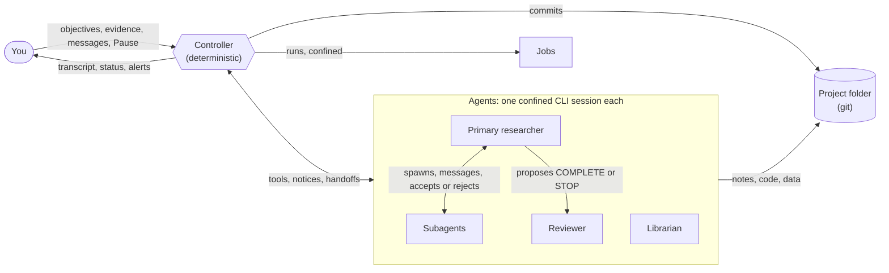

# Research Pipeline

An autonomous research investigator. You give it objectives (research questions
to answer or research tasks to perform), starting evidence and tools; a **primary researcher** agent leads the investigation, spawns
**subagents** for subproblems, runs computations and writes what it learns into an
ordinary project folder. When it judges the work done it proposes **COMPLETE**,
which an independent **Reviewer** must agree with, or **STOP**. A **Librarian**
keeps a library of pages that lead to the finished work. You judge the
science. The specification is [PROJECT.md](PROJECT.md); [docs/](docs/OVERVIEW.md) describes each
part and what it does under each condition.



Agents run on agent CLIs (Codex and Claude Code today), each in a persistent
session inside its own `bwrap` confinement. A deterministic controller makes every
operational decision:
- it keeps an agent's session while it waits, and hands it off to a fresh session at 55% context, measured
  from the CLI's own reports, or after 58 idle minutes;
- it pauses a CLI's agents when its usage quota runs low;
- it runs long jobs, confined too, that survive handoffs and restarts;
- it notices agents that stop working and tells whoever can act;
- it commits the project to git at every significant event.

## Requirements

- Linux with [bubblewrap](https://github.com/containers/bubblewrap) (`bwrap`), git and Python 3.11+.
- [uv](https://docs.astral.sh/uv/).
- At least one agent CLI, installed and logged in: [Codex](https://github.com/openai/codex) (`codex`)
  and/or [Claude Code](https://docs.claude.com/en/docs/claude-code) (`claude`).
- SSH access to the private repository `OtiDioti/agent_toolkit`, which `uv sync` installs as a dependency, at the
  release tag pinned in `pyproject.toml`.

## Install

```bash
git clone git@github.com:OtiDioti/research_pipeline.git
cd research_pipeline
uv sync                     # creates .venv with the research-pipeline command
uv tool install -e .        # optional: research-pipeline on your PATH
```

## Prepare a project

You can start from any folder, even one that does not exist yet: the web app's
setup page helps you add your material (and remove what you added by mistake),
place it in `starting_evidence/` and write the objectives, by hand or with the help
of a setup assistant ([docs/SETUP.md](docs/SETUP.md)). With `--no-web`, prepare it
yourself.

A project is a folder (not under `/tmp`) containing at least the objectives:

```text
my-project/
├── AGENTS.md                         optional instructions, given to every agent
└── starting_evidence/
    ├── FOLDER_CONTENT.md             one line describing each entry here
    ├── OBJECTIVES.md                 the authoritative objectives: questions or tasks
    ├── ...                           papers, notes, data
    └── tools/                        optional tools of yours
```

Before the first run nothing else may sit at the top level, and
`starting_evidence/FOLDER_CONTENT.md` must describe every entry at its top. The
controller creates the rest of the layout (PROJECT.md §2) and a git
repository on the first run. A project made before the library (with `sources/`
or `tools/` at its top level) is refused: start a new one. Agents can read everything except the controller's
`.research/` folder, and write only their own `agents/<id>/` folder. Only the
primary writes `STATUS.md` and `REPORT.md`; only the Reviewer writes `reviews/`;
only the Librarian writes the pages of `library/`, through the controller.

When a subagent is accepted or cancelled, and at the end for the primary and the
Reviewer, its folder is **shelved**: catalogued in `library/CATALOG.md` and frozen
in place (nothing moves, so every path stays valid). The Librarian then links the
work from its pages, starting at `library/LIBRARY.md`, organised for you: what was
established or built for each objective, how, and with which tools
([docs/LIBRARY.md](docs/LIBRARY.md)). `starting_evidence/` is yours
alone: agents and their jobs can only read it, so your tools there should write
their output to a path they are given, never next to themselves.

Agents and jobs can reach remote machines, such as a computing cluster, over SSH
with your keys. Describe the machine and its rules in a file in
`starting_evidence/`, point to it from `AGENTS.md`, and never write passwords
there. See [SSH and remote machines](docs/CONFINEMENT.md#ssh-and-remote-machines).

To run the benchmark, copy `research_example/` somewhere outside this repository
first, so that the investigation's git history stays separate from the code's.

## Run

```bash
research-pipeline run my-project
```

opens the web app in your browser: its setup page helps you get the folder ready and
offers every option below, then Start shows the investigation as a live graph. The
terminal prints the transcript. Without the page:

```bash
research-pipeline run my-project --no-web --primary codex:gpt-6.1-sol:high --reviewer claude:opus:high \
    --librarian claude:opus:high --max-agents 4
```

| Option | Meaning (default) |
|---|---|
| `--primary`, `--reviewer`, `--librarian` | CLI, model and effort as `BACKEND:MODEL:EFFORT` (chosen on the setup page; all three required on the first run with `--no-web`) |
| `--setup` | the setup assistant's `BACKEND:MODEL:EFFORT` (`codex:gpt-6.1-sol:high`; also on the page) |
| `--backends` | CLIs agents may choose for subagents (those of the primary and Reviewer) |
| `--max-agents` | agent sessions open at the same time, idle ones included, the Librarian's aside (6, at least 2); a spawn beyond it is refused |
| `--reference PATH` | another project, as unverified evidence; the primary is told about it (repeatable) |
| `--short-limit`, `--weekly-limit` | % left of a CLI's short or weekly usage window that pauses its agents (15) |
| `--context-threshold` | context fill that triggers a handoff (0.55, at most 0.8); keep it well above a fresh session's own start-up context |
| `--idle-limit MINUTES` | minutes an idle session waits before it saves its handoff and closes (58, inside the prompt cache's hour; 0: never) |
| `--no-durable-state` | write the controller's state without forcing it to disk (for slow network filesystems) |
| `--tui` | show the terminal app instead of printing the transcript |
| `--no-web` | no web app (the folder must be ready already) |
| `--start`, `--web-port PORT`, `--web-no-open` | skip the setup page; the page's port; print its address instead of opening the browser (see [docs/WEB.md](docs/WEB.md)) |

`--web` and `--no-tui`, the defaults now, are still accepted. The models the agents'
prompt recommends for subagents (coding: `claude:claude-opus-5-5:xhigh`, analysis:
`codex:gpt-6.1-sol:xhigh`) are set on the setup page, at every launch.

Running the same command again resumes a paused, shut down or interrupted
investigation. After COMPLETE or STOP the program stays open: you can still talk
with the primary and the Reviewer about their work, talk-only, until you quit; a
later `run` opens talk-only again, and reopens the investigation only if you changed
your files (e.g. a line in FEEDBACK.md) ([docs/FINISHING.md](docs/FINISHING.md)). Options given again replace the stored
ones. `research-pipeline status my-project` prints the state without starting
anything.

### The terminal app

With `--tui`, the app shows the transcript, the agent tree (status, CLI, context fill, latest
activity), the usage quota and a chat box. Lines marked ALERT need you, for
example when the primary has stopped and waits for your answer.

| Control | Effect |
|---|---|
| Chat box, Enter | Message to the primary researcher, delivered during its turn (during a review or a pause it answers you, talk-only) |
| Ctrl+P | Pause: agents at work finish their current step and wait in their sessions; jobs stop. Edit any file, then Ctrl+P again to resume in the same sessions |
| Ctrl+R | Resume agents held by a weekly or unreadable quota, or failed agents no longer retried automatically (jobs keep running) |
| Ctrl+Q / F10 | Exit cleanly (also while paused): every agent saves its handoff, jobs keep running; the next `run` resumes and reattaches them |
| F2 / F3 | Show one agent's transcript / all agents |
| Ctrl+C | Exit at once; jobs keep running, and the next `run` restarts agents from their handoffs |

### The web app

The page first helps you make the folder ready, before the first
start (material, objectives, an optional setup assistant: [docs/SETUP.md](docs/SETUP.md)),
then shows every option as a setup form (Start begins the investigation), then the agent tree as a live graph: every agent that ever worked,
coloured by status, with its context use, its messages (coloured by sender) and
tool calls, its documents, jobs and the websites it used. Single agents can be
messaged, paused and resumed, sent to a fresh session, or cancelled; the handoff
threshold, usage limits, number of sessions, idle limit, the CLI choices and the recommended models can be changed while it runs. See
[docs/WEB.md](docs/WEB.md).

You may edit your own files (`OBJECTIVES.md`, `AGENTS.md`, `FEEDBACK.md`,
starting evidence) at any time: the primary is told, and a new `AGENTS.md`
reaches every agent at its next session. Edit agent-written files only while
paused or shut down: when the investigation resumes, the agents concerned are told
what changed meanwhile (by you, or by jobs that kept running).

## How an investigation runs

- **Agents and subagents.** An agent spawns a subagent by writing a brief and
  calling `spawn` with the subagent's CLI, model and effort. It is told when the
  subagent submits `RESULT.md`, and then accepts the result, or rejects it with
  feedback (the subagent continues). Meanwhile the parent keeps doing whatever does
  not depend on the subagent, and ends its turn only when nothing useful remains.
  A parent and its subagents can message each other at any time. Subagents can
  spawn their own.
- **Instructions.** Every agent's instructions come from the controller alone:
  its role prompt and your `AGENTS.md`. The CLIs load nothing of your own setup
  (personal instruction files, skills, plugins, MCP servers); your own use of the
  CLIs is unaffected. If a CLI reports having loaded some of it anyway, the session
  does not start and you are told what to remove; then press Ctrl+R.
- **Handoffs.** At the context threshold an agent is asked, during its turn, to
  update `HANDOFF.md` and end the turn; a fresh session continues from it. The
  request repeats every further 25 points of context. Agents are never killed for
  overshooting. Context use comes only from each CLI's own reports; until a
  session's CLI has reported it, it shows as unknown and triggers nothing; if it is
  still unknown after the session's first turn, you get an ALERT.
- **Waiting keeps the session.** An agent waiting for a review, a verdict, its
  parent's decision, a pause or a quota hold keeps its session and context. A
  session idle for `--idle-limit` minutes updates `HANDOFF.md` and closes; the
  agent's next input starts a fresh session from it. Idle sessions count against
  `--max-agents` until they close.
- **Idle and stalled agents.** An agent that ends its turn with nothing running or
  pending is reminded once. If it ends its turn idle again, it has stalled: a
  subagent's parent is told (and may message it or cancel it), you are alerted for
  the primary and for the Librarian (idle only while shelving requests are pending),
  and a stalled Reviewer's round is withdrawn.
- **Jobs.** `run_job(command, timeout_seconds)` runs a computation outside the
  agent's session, in its own confinement (`starting_evidence/`, `library/` and
  shelved folders read-only, `.research/` hidden), with its output in
  `agents/<id>/jobs/`. The owner is told
  when it ends.
- **Finishing.**
  - COMPLETE: the primary writes `REPORT.md` and `HANDOFF.md` and calls `complete`.
    It then waits in its session, talk-only, while the Reviewer examines the work as
    committed at the proposal and writes a review to `reviews/`. COMPLETE stands
    only if the Reviewer agrees; otherwise the review reaches the primary in the
    same session, and it continues or stops.
  - STOP: the Reviewer first challenges the primary's reasons, then the primary
    decides.
  - At the end, the Librarian places the primary's and the Reviewer's work (unless
    it cannot run: then at the next `run`), and the program stays open for talks
    with the primary and the Reviewer until you quit.
- **Quota.**
  - A CLI's short window at 15% or less left: its agents update their handoffs and
    wait in their sessions until the reset.
  - A weekly window at 15% or less left, or quota that can't be read twice in a row: its
    agents pause until you resume them (Ctrl+R, or Resume when nothing is working).
  - Only the held CLI's agents pause, whichever CLI the primary uses. Jobs keep
    running through quota pauses.
- **Failures.** If a session crashes or a turn fails (for example, an API outage), the
  agent restarts from its handoff after 30 s, 2 min and 10 min; after that, Ctrl+R retries it.

Controller state and session logs are in `.research/` (not committed, and hidden
from agents and jobs).

## Development

```bash
uv run python -m unittest discover -s tests -t .     # unit and integration tests (no model usage)
uv run python -m tests.live_smoke                     # live run through the real CLIs (uses quota)
```

The web app's live checks (the page driven in Chrome against real sessions) are in
agent_toolkit's `web-ui/live/` (`node live/research.cjs`, `node live/alongside.cjs`).

The code is in `src/research_pipeline/`; [FOLDER_CONTENT.md](src/research_pipeline/FOLDER_CONTENT.md)
describes each module. Everything specific to one agent CLI (the drivers, the
confinement, the quota probes) lives in the shared package `agent_toolkit`, together
with the machinery research_pipeline shares with coding_pipeline and project_manager:
the handoff rules, the usage guard, durable records, the safe git runner, strict prompt
files and the terminal app. A new CLI is one driver there, and research_pipeline needs
no change. To work on both at
once, point `[tool.uv.sources]` in `pyproject.toml` at a local checkout
(`agent-toolkit = { path = "../agent_toolkit", editable = true }`).
