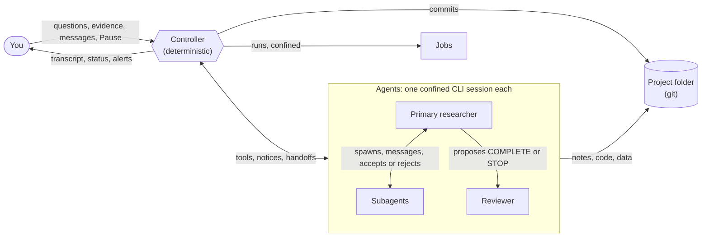

# Research Pipeline

An autonomous research investigator. You give it research questions, starting
evidence and tools; a **primary researcher** agent leads the investigation, spawns
**subagents** for subproblems, runs computations and writes what it learns into an
ordinary project folder. When it judges the work done it proposes **COMPLETE**,
which an independent **Reviewer** must agree with, or **STOP**. You judge the
science. The specification is [PROJECT.md](PROJECT.md); [docs/](docs/OVERVIEW.md) describes each
part and what it does under each condition.



Agents run on agent CLIs (Codex and Claude Code today), each in a persistent
session inside its own `bwrap` confinement. A deterministic controller makes every
operational decision:
- it hands an agent off to a fresh session at 55% context, measured from the CLI's own reports;
- it pauses a CLI's agents when its usage quota runs low;
- it runs long jobs, confined too, that survive handoffs and restarts;
- it notices agents that stop working and tells whoever can act;
- it commits the project to git at every significant event.

## Requirements

- Linux with [bubblewrap](https://github.com/containers/bubblewrap) (`bwrap`), git and Python 3.11+.
- [uv](https://docs.astral.sh/uv/).
- At least one agent CLI, installed and logged in: [Codex](https://github.com/openai/codex) (`codex`)
  and/or [Claude Code](https://docs.claude.com/en/docs/claude-code) (`claude`).

## Install

```bash
git clone git@github.com:OtiDioti/research_pipeline.git
cd research_pipeline
uv sync                     # creates .venv with the research-pipeline command
uv tool install -e .        # optional: research-pipeline on your PATH
```

## Prepare a project

A project is a folder (not under `/tmp`) containing at least the questions:

```text
my-project/
├── AGENTS.md                         optional instructions, given to every agent
└── starting_evidence/
    ├── RESEARCH_QUESTIONS.md         the authoritative questions
    ├── ...                           papers, notes, data
    └── tools/                        optional tools of yours
```

The controller creates the rest of the layout (PROJECT.md §2) and a git
repository on the first run. Agents can read everything except the controller's
`.research/` folder, and write only their own `agents/<id>/` folder and the
shared `sources/` and `tools/`. Only the primary writes `STATUS.md` and
`REPORT.md`; only the Reviewer writes `reviews/`. `starting_evidence/` is yours
alone: agents and their jobs can only read it, so your tools there should write
their output to a path they are given, never next to themselves.

To run the benchmark, copy `research_example/` somewhere outside this repository
first, so that the investigation's git history stays separate from the code's.

## Run

```bash
research-pipeline run my-project --primary codex:gpt-6.1-sol:high --reviewer claude:opus:high --max-agents 4
```

| Option | Meaning (default) |
|---|---|
| `--primary`, `--reviewer` | CLI, model and effort as `BACKEND:MODEL:EFFORT`, all three required (on the first run) |
| `--backends` | CLIs agents may choose for subagents (those of the primary and Reviewer) |
| `--max-agents` | agents working at the same time (4); a spawn beyond it is refused |
| `--reference PATH` | another project, as unverified evidence; the primary is told about it (repeatable) |
| `--short-limit`, `--weekly-limit` | % left of a CLI's short or weekly usage window that pauses its agents (15) |
| `--context-threshold` | context fill that triggers a handoff (0.55); keep it well above a fresh session's own start-up context |
| `--no-tui` | print the transcript instead of the terminal app |

Running the same command again resumes a paused, shut down or interrupted
investigation, or reopens a finished one. Options given again replace the stored
ones. `research-pipeline status my-project` prints the state without starting
anything.

### The terminal app

The app shows the transcript, the agent tree (status, CLI, context fill, latest
activity), the usage quota and a chat box. Lines marked ALERT need you, for
example when the primary has stopped and waits for your answer.

| Control | Effect |
|---|---|
| Chat box, Enter | Message to the primary researcher, delivered during its turn (during a review it wakes the primary to answer you) |
| Ctrl+P | Pause: every agent hands off, then jobs stop. Edit any file, then Ctrl+P again to resume |
| Ctrl+R | Resume agents held by a weekly or unreadable quota, or whose session could not start (jobs keep running) |
| Ctrl+Q / F10 | Exit cleanly: every agent hands off, jobs keep running; the next `run` resumes and reattaches them |
| F2 / F3 | Show one agent's transcript / all agents |
| Ctrl+C | Exit at once; jobs keep running, and the next `run` restarts agents from their handoffs |

You may edit your own files (`RESEARCH_QUESTIONS.md`, `AGENTS.md`, `FEEDBACK.md`,
starting evidence) at any time: the primary is told, and a new `AGENTS.md`
reaches every agent at its next session. Edit agent-written files only while
paused or shut down: when the investigation resumes, the agents concerned are told
what changed meanwhile (by you, or by jobs that kept running).

## How an investigation runs

- **Agents and subagents.** An agent spawns a subagent by writing a brief and
  calling `spawn` with the subagent's CLI, model and effort. It is told when the
  subagent submits `RESULT.md`, and then accepts the result, or rejects it with
  feedback (the subagent continues). A parent and its subagents can message each
  other at any time. Subagents can spawn their own.
- **Instructions.** Every agent's instructions come from the controller alone:
  its role prompt and your `AGENTS.md`. The CLIs load nothing of your own setup
  (personal instruction files, skills, plugins, MCP servers); your own use of the
  CLIs is unaffected. If a CLI reports having loaded some of it anyway, the session
  does not start and you are told what to remove; then press Ctrl+R.
- **Handoffs.** At the context threshold an agent is asked, during its turn, to
  update `HANDOFF.md` and end the turn; a fresh session continues from it. The
  request repeats every further 25 points of context. Agents are never killed for
  overshooting. Context use comes only from each CLI's own reports; until a
  session's CLI has reported it, it shows as unknown and triggers nothing.
- **Idle and stalled agents.** An agent that ends its turn with nothing running or
  pending is reminded once. If it ends its turn idle again, it has stalled: a
  subagent's parent is told (and may message it or cancel it), you are alerted for
  the primary, and a stalled Reviewer's round is withdrawn.
- **Jobs.** `run_job(command, timeout_seconds)` runs a computation outside the
  agent's session, in its own confinement (`starting_evidence/` read-only,
  `.research/` hidden), with its output in `agents/<id>/jobs/`. The owner is told
  when it ends.
- **Finishing.**
  - COMPLETE: the primary writes `REPORT.md` and `HANDOFF.md` and calls `complete`.
    Its session then closes while the Reviewer examines the work and writes a
    review to `reviews/`. COMPLETE stands only if the Reviewer agrees; otherwise the
    primary restarts with the review and continues or stops.
  - STOP: the Reviewer first challenges the primary's reasons, then the primary
    decides.
- **Quota.**
  - A CLI's short window at 15% or less left: its agents hand off and pause until
    the reset.
  - A weekly window at 15% or less left, or quota that can't be read: its agents
    pause until you resume them (Ctrl+R, or Resume when nothing is working).
  - If the primary's CLI is affected, everyone pauses. Jobs keep running through
    quota pauses.
- **Failures.** If a session crashes or a turn fails (for example, an API outage), the
  agent restarts from its handoff after 30 s, 2 min and 10 min; after that, Ctrl+R retries it.

Controller state and session logs are in `.research/` (not committed, and hidden
from agents and jobs).

## Development

```bash
uv run python -m unittest discover -s tests -t .     # unit and integration tests (no model usage)
uv run python -m tests.live_smoke                     # live run through the real CLIs (uses quota)
```

The code is in `src/research_pipeline/`; [FOLDER_CONTENT.md](src/research_pipeline/FOLDER_CONTENT.md)
describes each module. Everything specific to one agent CLI lives in its driver in
`drivers/`. To support another CLI, write one session driver there and register it
in `drivers/__init__.py`. The driver provides:
- `command`: the CLI's command line, with its own discovery switched off;
- `begin`: its handshake, reporting what the CLI loaded to the shared setup check;
- `deliver`: message delivery during a turn;
- `receive`: turning its output into the controller's events, including context use from its own reports;
- where needed, `state_paths`, `masked_paths` and `read_usage`, its quota probe.

Everything else (confinement, tools, handoffs, jobs, quota policy) is shared.
