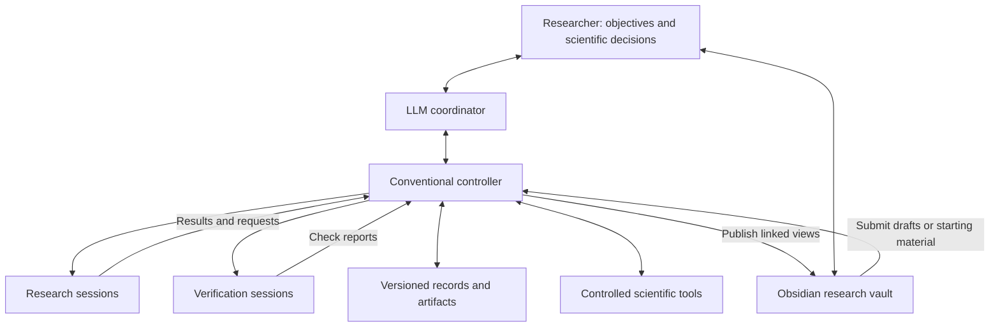
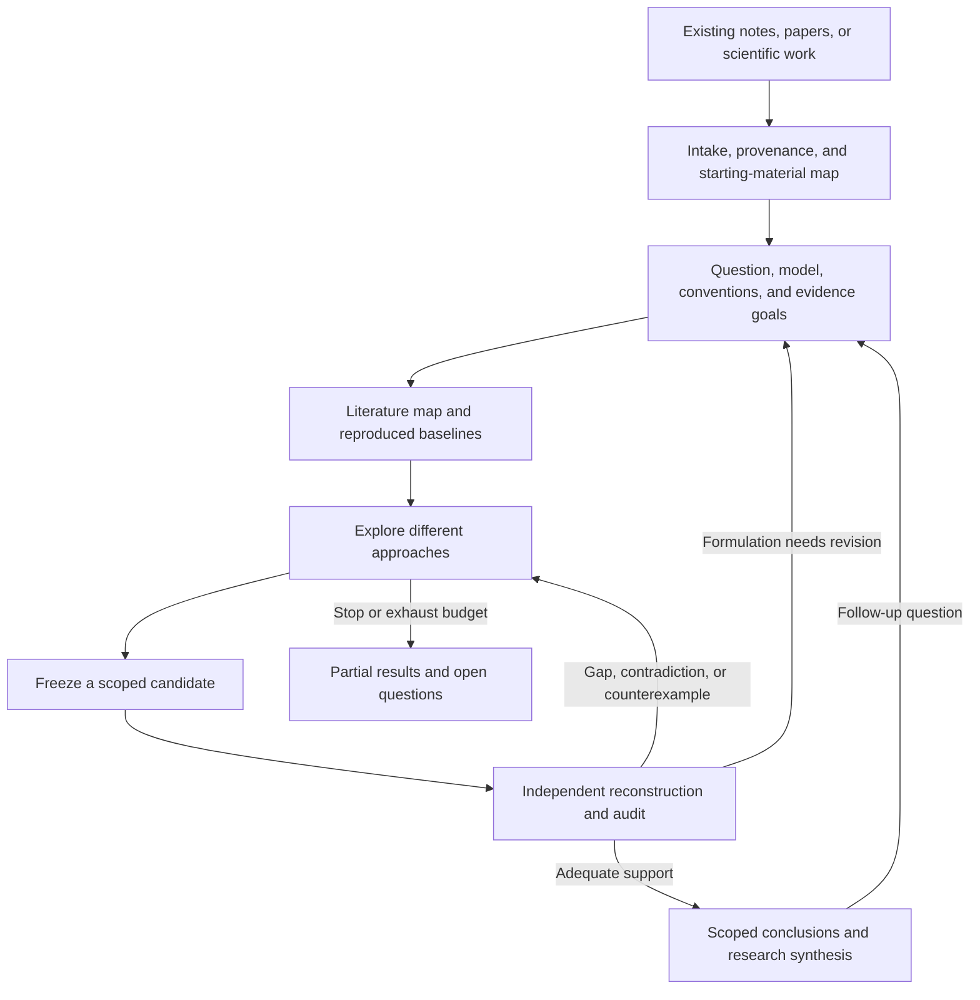
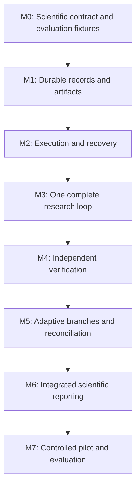

# LLM Pipeline for Theoretical Scientific Research

## Project Design and Development Plan

**Version:** 1.3  
**Date:** 29 October 2026  
**Status:** Consolidated planning proposal; implementation has not started.  
**Primary domain:** Theoretical physics, with a domain-independent core for other theoretical sciences.

**Main goal:** Help a human researcher obtain scientifically useful, defensible progress by combining LLM-driven exploration with explicit assumptions, reproducible work products, independent verification, and a persistent record of what is supported, disputed, or unresolved.

**Proposed architecture:** A conventional controller manages a durable research record and creates bounded LLM sessions for coordination, research, and verification. An adaptive scientific workflow operates on a graph of claims and justifications; a separate task graph manages execution. A versioned tool registry supports supplied and agent-developed capabilities, and a readable research workspace organizes notes, LaTeX derivations, papers, calculations, and reports. Agents propose and assess scientific work, while the controller enforces access, persistence, budgets, and review procedures.

**Proposed initial implementation:** A local Python application, a transactional SQLite record store, immutable artifact files, a model-provider adapter, controlled tool execution, and a CLI paired with an Obsidian research vault. Each project begins from an existing collection of scientific materials. The seeded startup and Obsidian organization follow the researcher's requirements; specific backend technologies and operating defaults remain proposals.

**Scope of this document:** The scientific design, system architecture, interfaces, operational policies, evaluation strategy, and phased development plan are specified together. This is a project-level design and roadmap, not executable software or a promise that arbitrary scientific claims can be certified automatically.

The scientific architecture is independent of the particular tools available to a project. Tools are selected, supplied, or developed to meet scientific needs through common interfaces; no specific package, provider, external workflow, or user-supplied tool set is required. Section 10 describes this extensibility and the additional contracts for optional composite tools.

**Revision 1.1:** Integrates extensible tools, delegated software development, mandatory intake of existing scientific materials, an Obsidian vault with linked research folders, Markdown and LaTeX authoring, research-note persistence, paper acquisition and reading reports, and the corresponding authority, evaluation, and implementation requirements.

**Revision 1.2:** Makes tool selection explicitly project-dependent, generalizes composite-tool integration, and aligns examples, evaluation, and milestones with optional tool availability.

**Revision 1.3:** Specifies dependency-led context selection and compression, resource-reserved session handoffs and recovery from token exhaustion, and a mandatory end-of-run report with a model-independent fallback. Aligns the affected records, interfaces, defaults, and development tests with these contracts.

## Contents

1. [Purpose, outcomes, and scope](#1-purpose-outcomes-and-scope)
2. [Architectural choices and governing principles](#2-architectural-choices-and-governing-principles)
3. [The complete scientific workflow](#3-the-complete-scientific-workflow)
4. [Components, agent roles, and authority](#4-components-agent-roles-and-authority)
5. [The persistent scientific and operational model](#5-the-persistent-scientific-and-operational-model)
6. [Communication, independence, and context construction](#6-communication-independence-and-context-construction)
7. [Verification and claim promotion](#7-verification-and-claim-promotion)
8. [Scheduling, budgets, and stopping](#8-scheduling-budgets-and-stopping)
9. [Storage, transactions, recovery, and reproducibility](#9-storage-transactions-recovery-and-reproducibility)
10. [Interfaces, tools, and the researcher experience](#10-interfaces-tools-and-the-researcher-experience)
11. [Evaluation and success criteria](#11-evaluation-and-success-criteria)
12. [Implementation scope and development roadmap](#12-implementation-scope-and-development-roadmap)
13. [Worked research and recovery scenarios](#13-worked-research-and-recovery-scenarios)
14. [Proposed defaults, open choices, and risks](#14-proposed-defaults-open-choices-and-risks)
15. [Coverage and consistency checklist](#15-coverage-and-consistency-checklist)
16. [Evidence base and references](#16-evidence-base-and-references)

### Navigation for workspace and tool design

| Design question | Detailed location |
| --- | --- |
| What must exist before a project starts? | [Starting-material intake](#32-mandatory-intake-of-starting-materials) |
| Where does each kind of research content live? | [Directory structure](#97-prescribed-research-directory-structure) and [folder documentation](#98-folder-documentation-and-discovery) |
| How do humans browse and edit the project? | [Obsidian vault](#911-obsidian-navigation-and-the-complete-project-vault) and [draft import](#910-editing-imports-retention-and-portability) |
| How can tools be supplied or developed? | [Tool catalog](#106-an-extensible-tool-catalog), [qualification](#107-tool-construction-qualification-and-reuse), and [composite workflows](#108-composite-tools-and-delegated-workflows) |
| How are notes and mathematics preserved? | [Research notes](#99-notes-journals-notebooks-and-checkpoints) and [derivation bundles](#109-mathematical-authoring-and-derivation-bundles) |
| How are papers and their reports handled? | [Literature workflow](#1010-paper-acquisition-reading-and-literature-reports) and [report types](#1011-report-types-figures-and-reading-paths) |

## 1. Purpose, outcomes, and scope

### 1.1 The scientific objective

The system should increase the amount of defensible scientific progress a researcher can make within a fixed budget of attention, time, and computation. It should help formulate questions, locate relevant results, explore alternatives, perform calculations, expose errors, and assemble research outputs whose conclusions can be traced to their actual support.

Useful outcomes include:

- An analytical relation or a conditional theorem.
- A controlled approximation with an explicit regime and error assessment.
- A numerical result with appropriate convergence and uncertainty evidence.
- A bound, construction, or counterexample.
- A justified restriction of a conjecture or a model's applicability.
- A well-supported negative result or reason to abandon an approach.
- A useful new research question or a clearly labeled conjecture.

A manuscript is one possible presentation of these outcomes. Manuscript count, agent agreement, and task completion are not sufficient measures of scientific success.

### 1.2 What reliability means

Reliability means that the system preserves the distinction between what was assumed, what was calculated, what was checked, and what can reasonably be concluded. It must expose uncertainty and support correction when new evidence appears.

Four assessments remain separate:

| Assessment | Central question |
| --- | --- |
| Mathematical validity | Does the argument establish the stated proposition under its premises? |
| Computational support | Do the calculations implement the intended problem and support the stated numerical conclusion? |
| Physical applicability | Does the modeled problem, regime, and observable address the scientific question? |
| Novelty and significance | How does the result differ from prior work, and why does it matter? |

Physical applicability may remain conditional. A valid result within a model does not by itself establish that the model describes a real system. Where empirical support is needed and unavailable, the system must preserve that limitation.

There is no general-purpose correctness oracle for original theoretical research. The architecture therefore combines explicit proof obligations, complementary checks, inspectable evidence, and human scientific judgment. Its effectiveness must be evaluated empirically rather than inferred from the number of agents or the sophistication of its workflow.

### 1.3 Initial scope

The first version should support one researcher, one local project at a time, bounded parallel work, and a deliberately narrow initial physics problem family. The records and interfaces should remain general enough to accommodate other domains later.

Every project must start from an existing scientific collection: the researcher's notes, papers, derivations, notebooks, prior calculations, or a mixture. The system inventories and interprets this starting material before admitting the main investigation. A project is organized as one Obsidian vault, containing its readable scientific record and linked artifacts, with controller-managed operational storage kept in designated internal areas. Human navigability is a design requirement alongside reproducibility.

The initial system should support literature retrieval, explicit derivations, symbolic calculations, numerical jobs, independent checking, structured review, checkpointing, and research reports. Formal proof assistants are optional adapters for suitable subproblems, not a requirement for all work.

Researchers may supply programs, packages, notebooks, command-line tools, services, or agentic development workflows. Agents may also write task-specific programs and propose reusable tools. These capabilities operate through the same version, permission, execution, and evidence contracts as built-in tools. Downloading permitted papers, writing paper reports, and preserving exploratory notes are ordinary research operations within the approved envelope.

The first version should not attempt autonomous publication, unrestricted agent spawning, automatic scientific equivalence detection, universal theorem proving, or fully autonomous selection of an entire long-term research agenda. It should not train model weights online. Durable project memory supplies continuity across calls and sessions.

### 1.4 Human and system responsibilities

The researcher selects or approves the scientific objective, the initial model and research envelope, consequential changes of direction, and the central conclusions selected for external communication. Routine exploration and checking within the approved envelope should proceed autonomously.

The research envelope specifies the allowed questions, model families, kinds of approximation, tools, data access, resource limits, and decisions requiring human review. Explorers may investigate alternatives within this envelope. An alternative model remains an explicitly labeled branch until the researcher adopts it as the main direction.

These are proposed autonomy defaults. The user's preferences should be configurable before a real research run.

## 2. Architectural choices and governing principles

### 2.1 Alternatives considered

| Organization | Strength | Limitation | Role in this project |
| --- | --- | --- | --- |
| One researcher agent with tools | Low coordination overhead and coherent context | Discovery and checking can share the same mistakes | Required baseline; also suitable for coherent individual tasks |
| A standing committee with broad discussion | Easy exchange of ideas and criticism | Agreement may reflect shared assumptions or influence rather than new evidence | Not the default organization |
| Bounded task-specific sessions around persistent state | Selective collaboration, independent checking, recoverable work, and explicit provenance | Requires careful state and visibility management | Recommended architecture |

The recommendation is multi-agent in the sense of distinct role-scoped sessions. It does not require different base models, permanently running conversations, or parallel execution at every stage. One model can serve all roles sequentially. Additional sessions are justified by a concrete scientific or verification benefit.

Research on agent scaling reports substantial dependence on task structure, including coordination costs on sequential tasks [R1]. This supports retaining a strong single-agent baseline and measuring the contribution of each additional role. It does not establish a universal optimum for theoretical physics.

### 2.2 System invariants

1. **Scientific state outlives sessions.** Important claims, derivations, evidence, failures, and decisions must not exist only in a conversation.
2. **Every claim has a scope.** Its assumptions, domains, conventions, and approximation qualifications remain attached to it.
3. **Claims and justifications are different records.** Defeating one argument need not refute its conclusion.
4. **Execution state and scientific support are different.** A completed task may produce a counterexample or no defensible result.
5. **Exploration may be speculative.** Promotion into supported research requires evidence appropriate to the claim.
6. **Exact versions matter.** Checks refer to fixed candidates, inputs, artifacts, and policies.
7. **Independence is described, not assumed.** Record shared premises, sources, methods, code, and communications.
8. **The controller is the canonical writer.** Agents submit proposals and artifacts through controlled interfaces.
9. **History is retained.** Revisions, failed checks, negative results, and unresolved objections remain inspectable.
10. **No status change creates scientific truth.** Mechanical gates enforce procedure; substantive support still requires scientific assessment.
11. **Budget exhaustion is an admissible outcome.** An unresolved investigation must not be converted into a success narrative.
12. **Reports preserve epistemic limits.** Synthesis cannot silently strengthen a claim beyond its evidence.
13. **Tool availability and scientific validity are separate.** Permission to execute software and qualification for a tested use do not establish every result it produces.
14. **Readable files have explicit authority.** Drafts, immutable artifacts, and generated directory views are distinguished; changing a Markdown file cannot silently change a scientific disposition or operating policy.
15. **Projects start from real material.** An admitted initial corpus and an intake record precede the main research run; a tool catalog or empty template alone is not a scientific starting point.

### 2.3 Overall component structure

The coordinator proposes scientific actions. The controller validates and schedules them, constructs permitted context, executes tools, records events, and applies authorized transitions. Research and verification sessions produce explicit work products. The record store and artifact store preserve the investigation. Tool adapters make symbolic, numerical, retrieval, and optional formal methods available without embedding a particular scientific backend in the orchestration logic.

The controller mediates communication but should not rewrite the mathematical content of messages. Original submissions remain available alongside any generated summaries. The tool registry, workspace materializer, and source-ingestion functions are initially modules of this application. If a project uses a composite or agentic tool, it operates behind the same controller boundary, with explicit delegation rules for its own calls and subagents. The vault is the human's project workspace; its submission arrow denotes the controlled import interface, not permission for arbitrary note edits to mutate canonical state.

## 3. The complete scientific workflow

### 3.1 Lifecycle overview

This is a revisitable workflow. A run can return to literature work, revise a question, preserve a partial result, or stop a branch. Candidate acceptance points are strict even though the investigation remains flexible.

### 3.2 Mandatory intake of starting materials

Create a project from a selected, pre-existing collection of relevant scientific material. Accept Markdown or text notes, LaTeX sources, PDFs, scanned or handwritten notes with suitable inspection, notebooks, prior calculation bundles, and combinations of these. An existing Obsidian vault can be an import source. A short but substantive mathematical note can be sufficient, including scientific content the researcher pastes into the interface and the system captures with provenance. A bare title, empty README, unattached citation list, or an agent-generated placeholder is not sufficient by itself.

The startup procedure is:

1. **Select and preserve.** Record the supplied or explicitly selected material, origin, authorship where known, intended purpose, and access/processing constraints. Preserve original bytes and original organization in a versioned seed manifest. Do not move, rewrite, or reorganize the researcher's original vault in place.
2. **Inventory and classify.** Distinguish original research notes, published sources, calculations, software, data, prior reports, and operating instructions. Record duplicates, source versions, inaccessible files, and extraction limitations.
3. **Inspect a relevant subset.** Read enough to identify a usable starting question or problem family, definitions, assumptions, existing work, and likely gaps. Mark uninspected material explicitly; startup does not require exhaustive review of a large collection.
4. **Build an intake map.** Link source material to questions, provisional claims, derivations, conventions, unresolved issues, and candidate baseline tasks. Record contradictions and missing prerequisites instead of silently resolving them.
5. **Propose the research brief.** Derive an initial context and working objective from the material and the researcher's intent, linking each consequential choice to its origin or to an explicit new proposal.
6. **Record readiness.** Admit the main research run when a substantive relevant seed subset and intake report are committed, the scientific brief is usable, and the operating envelope is authorized under the project's decision policy.

A setup shell may exist in an `awaiting_materials` state. Bounded intake, permitted source acquisition, and clarification can occur during setup, but the controller must not launch open research against an empty or unreadable scientific collection. Readiness is a recorded prerequisite for research-task admission. If only paper references were initially supplied, acquisition can establish the starting collection before readiness; metadata alone does not imply that full text was inspected. Software capabilities and starting scientific material are separate inputs; software contributes to the seed collection only when it contains scientific content relevant to the investigation.

The seed manifest identifies exactly what was available at startup. Subsequent additions create new import and corpus revisions, leaving the original baseline intact. Existing notes are inputs, not automatically correct premises, and scientific text is not a source of operating permissions. User-selected working assumptions may be adopted explicitly without pretending they were proved. Imported prior reviews retain their provenance but do not automatically become local endorsements. Restoring a validated project backup is different from importing another project's files.

Readiness is a procedural judgment about available material and a usable assignment, not an endorsement of the seeds. Incomplete or conflicting material can be precisely why research is needed. Record unknown authorship or version information as unknown. Identify the inspected subset and unprocessed remainder explicitly; do not claim that inventorying a collection establishes that the whole collection was understood.

Preserve meaningful links from an imported vault and record a mapping from original paths to imported identities; unresolved or external links remain visible. Do not activate imported plugins, templates with executable behavior, or application configuration merely because they accompany the notes. The intake report lives under `reports/intake/<intake-id>/`, the seed inventory under `brief/seeds/<seed-id>/`, and original materials are linked into the appropriate source or branch views without losing their origin.

If the seed materials already contain an answer, derivation, or numerical reference, the later verification task must respect that exposure. A baseline that reads the original solution is source-informed reproduction. A fresh checker may receive a filtered problem packet when answer-blind checking is possible; the project cannot claim independence simply because the initial corpus was supplied by a human.

### 3.3 Frame the research question

The coordinator and researcher create a research brief with:

- Scientific motivation and intended contribution.
- Target observable, proposition, construction, or explanatory question.
- Model equations and mathematical domains.
- Definitions, units, conventions, and boundary or initial conditions.
- Parameter regime and relevant scales.
- Allowed approximations and known limitations.
- Existing results and suspected gaps.
- What would count as useful progress, including negative outcomes.
- Initial evidence requirements and resource limits.

The brief distinguishes firm premises from hypotheses to investigate. If the question is underspecified, the coordinator should first resolve what can be determined from available sources and existing project context, then surface only consequential remaining choices.

### 3.4 Build a literature and baseline map

Literature work produces source-linked records, not just a narrative survey. Each imported result should identify its precise statement, applicable assumptions, source location, and relevance to the current question. Critical equations should be checked against the original source when extraction or notation is ambiguous.

The system should reproduce at least one informative reference result, solvable limit, or small instance before interpreting an extension as progress. A baseline task states what it tests: conventions, model construction, numerical implementation, analytical machinery, or a combination.

A successful baseline provides evidence for those tested properties. It does not establish the correctness of all future calculations. Source existence and correct attribution also do not guarantee the source's scientific correctness.

The acquisition workflow in Section 10.10 saves the precise paper version, its original file when accessible, extraction provenance, reading coverage, and a separate critical reading report. Section 9 fixes their locations. A metadata record, downloaded PDF, inspected passage, and reproduced result are distinct achievements.

### 3.5 Explore alternative routes

The coordinator proposes a small set of approaches, with a reason for each. Methodological differences are preferred: an analytical expansion, a variational bound, an alternative representation, a numerical investigation, or a counterexample search.

Each active branch records its working hypotheses, current scope, main uncertainty, cheapest informative next action, and continuation or stopping rationale. Explorers may use analogies, toy models, suggestive numerics, and incomplete arguments, provided their status is explicit.

Research tasks should be large enough to preserve coherent reasoning but bounded enough to yield an inspectable result. A long derivation can remain in one session; independently useful methods and checks can run in separate sessions.

Each approach accumulates versioned notes, derivation drafts, and calculation bundles under its branch. When a needed capability is missing, assess an available alternative method, tool import or integration, bounded tool development where supported, or an explicit blocked task. Any proposed development task has a scientific purpose, acceptance criteria, and budget. Building infrastructure is not itself evidence that the scientific investigation has progressed.

### 3.6 Construct a candidate package

A promising result becomes a candidate only after its precise statement and scope are recorded. The package contains the claim revision, context revision, all supporting justifications, exact evidence artifacts, unresolved obligations, and a proposed verification plan.

Freezing the package preserves the candidate being reviewed. It does not freeze the whole project. Any later change to the proposition, assumptions, derivation, code, or decisive inputs creates a new revision and identifies which checks require reassessment. The package pins its mathematical source files, macro and bibliography dependencies, program and tool releases, numerical inputs, and execution evidence. Human-readable folder locations are convenient routes to these versions, not substitutes for their identities.

### 3.7 Verify, challenge, and reconcile

Run inexpensive decisive checks first, followed by deeper checks appropriate to the claim. Where feasible, obtain an independent reconstruction before exposing the original argument. Then audit the actual candidate, including its assumptions, approximation regime, physical interpretation, and relation to the original objective.

A disagreement becomes a specific issue: identify the earliest disputed definition, premise, inference, or numerical observation, and commission a discriminating task. Neither majority voting nor repeated requests for a favorable review resolve a mathematical disagreement.

### 3.8 Assess novelty and significance again

Repeat the literature comparison once the result is precise. Look for equivalent formulations, changes of variables, known special cases, and results stated with different terminology. Record the closest prior results, the proposed difference, search coverage, and remaining uncertainty.

Correctness, novelty, and importance remain separate assessments. A correct rediscovery may still be valuable as a baseline or method check. A promising new conjecture may remain speculative. A useful negative result may deserve inclusion even if no preferred hypothesis survives.

### 3.9 Produce a research package

The output includes a readable report, a claim index, explicit derivations, executable calculations where applicable, source references, review evidence, assumptions and limitations, informative failed approaches, and next questions. Every substantive conclusion points to its supporting records.

The system may end with scoped supported results, a counterexample, a narrowed conjecture, an unresolved issue, or a justified decision to stop. A final report must state which of these occurred.

Every run also produces the end-of-run report defined in Section 10.5, including when it pauses or stops before the scientific objective is met. This minimum report preserves partial progress and a continuation route; a manuscript and a shareable release package are separate, richer deliverables. Ending a run does not imply completing the project or satisfying its research objective.

## 4. Components, agent roles, and authority

### 4.1 Components and responsibilities

| Component | Owns | Does not own |
| --- | --- | --- |
| Human researcher | Scientific priorities, consequential scope decisions, release of central conclusions | Routine execution of every calculation |
| LLM coordinator | Task proposals, scientific decomposition, prioritization recommendations, synthesis proposals | Permissions, unreviewed promotion, alteration of historical evidence |
| Research sessions | Assigned investigations and proposed scientific records | Canonical state changes or unrestricted spawning |
| Verification sessions | Independent work and evidence-based assessments | Repairing the reviewed artifact in place or declaring general truth by role authority |
| Controller | Scheduling, access, lifecycle, canonical commits, policy enforcement | Autonomous physical interpretation beyond the supplied assessments |
| Context service | Selection and assembly of permitted, versioned context | Unreviewed strengthening of claims through summaries |
| Record store | Structured project, scientific, operational, and decision records | Large artifact contents or scientific inference by storage alone |
| Artifact store | Exact saved work products and manifests | Replacing scientific review with file existence |
| Tool adapters | Reproducible execution and authentic tool results | Allowing generated code to alter the controller or evidence policy |
| Tool registry | Versioned capability descriptions, execution permissions, qualification evidence, and withdrawal status | Treating a tool's self-description or installation as scientific validation |
| Workspace materializer | Readable directory views, manifests, indexes, and controlled draft import | Becoming a second independent source of scientific status |

The context service, scheduler, and state manager can initially be modules inside one controller process. They are separate responsibilities, not a requirement for separate network services.

### 4.2 Coordinator

The coordinator receives the current objective, summaries linked to exact records, active branches, unresolved issues, task states, and remaining resources. It proposes ready tasks and explains why each is informative.

It should remain replaceable. Important planning decisions and reasons are persisted. A new coordinator can reconstruct the project without inheriting private conversational history.

The coordinator itself can introduce correlated errors through a mistaken problem formulation, narrow decomposition, selective attention, or information leakage. Foundational formulations therefore receive an explicit assumption audit, and independent checking packets should be constructed from approved snapshots rather than improvised hints.

### 4.3 Researcher sessions

A researcher receives a concrete objective, a method profile when useful, exact input versions, relevant branch history, permitted tools, a budget, and an output contract. It may submit conjectures, derivations, calculations, counterexamples, source records, issues, or scope-change proposals.

Analytical, numerical, literature, software-development, and synthesis assignments are initial specializations of this role. A tool-building assignment may use a coding agent or an admitted external development workflow. A separate checker assesses the proposed tool's consequential behavior before qualified reuse. Additional standing roles should be introduced only when evaluation shows a benefit.

A researcher may request subtasks or collaboration. It cannot recursively spawn an unbounded team, overwrite another branch, change common assumptions silently, or promote its own work by editing the database.

### 4.4 Independent checker and adversarial reviewer

An independent checker reconstructs a calculation or argument under a defined visibility policy. Its result is committed before the candidate is revealed when that independence is feasible.

An adversarial reviewer inspects the frozen candidate and attempts to identify errors, missing assumptions, counterexamples, inadequate uncertainty control, or exaggerated interpretation. Critiques must identify a specific issue and supporting reasoning or evidence.

For ordinary work, one session may perform independent reconstruction and then, after a recorded disclosure event, audit the candidate. A consequential claim may justify a fresh adversarial session. The resulting records must distinguish these cases.

The reviewer proposes disposition and required follow-up. It must not repair the original candidate in place. Corrections belong to a new candidate revision so that the original check remains auditable.

### 4.5 Session lifecycle

Create sessions for bounded work, not as a permanently running committee. Keep a session alive through a coherent investigation and its tool interactions. At task completion, a meaningful checkpoint, context pressure, a substantial input change, or an independence boundary, persist the work and end or replace it.

One session belongs to one execution attempt in the first version. Resuming in a fresh session creates a new attempt linked to the previous checkpoint. The scientific task retains its identity. This keeps input snapshots and exposure history unambiguous.

The controller, not the model's estimate of remaining capacity, initiates a handoff before the next action would consume reserved context or resources. Section 6.2 defines context fitting, Section 8.2 defines the reserves, and Section 9.4 defines the handoff and abrupt-stop fallback. A replacement session does not reset cumulative usage, task limits, or the exposure history inherited through its continuation materials.

The same base model may serve every role. Distinct sessions provide operational separation, not a guarantee of independent training influences or error distributions.

## 5. The persistent scientific and operational model

### 5.1 Core records

Every record has a stable identity, an explicit revision where its meaning can change, creation provenance, and links to the activities that produced or assessed it. Scientific content revisions are immutable. Current operational state and current assessments are maintained transactionally with an audit history.

| Record | Essential fields and relationships |
| --- | --- |
| Project | Objective, researcher, policies, resource limits, initial-corpus manifest, intake/readiness state, active approved context, and run history |
| Run | Project, policy and budget allocation, start and end snapshots, execution state, stop reason, handoff/closeout reservations, outstanding jobs and liabilities, and end-of-run report revision or pending-publication state |
| Corpus or seed manifest | Exact admitted material revisions, original paths and provenance, processing permissions, inspection coverage, unresolved imports, intake report, and later additions |
| Research context | Question, equations, definitions, units, conventions, domains, boundary conditions, parameter regime, approximations, and limit ordering |
| Branch | Parent branch or context, method, additional hypotheses, scope differences, continuation rationale, and current issues |
| Claim revision | Precise statement, claim category, quantifiers, context, assumptions, approximation qualifications, and open obligations |
| Justification | Premise claim revisions, required assumptions, method, conclusion claim revisions, evidence, and assessed limitations |
| Evidence record | Exact artifact references, target claim or property, method, inputs, tested scope, result, and uncertainty or failure details |
| Source record | Stable work identifier, exact upstream version and local capture revision, authorship, retrieval provenance, access and reuse metadata, original artifacts, extraction lineage, exact locations, reading coverage, and attributed statements |
| Work-product manifest | Kind such as note, derivation, calculation, notebook, checkpoint, reading report, or end-of-run report; identity and revision; author/task/branch/context and run where relevant; artifact hashes and entry file; linked claims and sources; supersession and build dependencies |
| Tool release | Stable tool identity, pinned local artifacts or available external-version identifiers, exact adapter/interface configuration, origin, environment, semantic contract, declared effects, requested capabilities, nested execution behavior, and version-observability limits |
| Tool assessment | Target release and environment, separately recorded execution permission and qualification scope, checks and limitations, issues, and withdrawal or replacement decision |
| Issue | Disputed point, affected records, objection or counterexample, severity, proposed discriminating action, and disposition |
| Review | Target candidate revision, reviewer, mode of independence, context manifest, executed checks, substantive assessment, and limitations |
| Promotion eligibility | Candidate revision, approved support routes, relevant assessment and issue revisions, current context, authorization policy revision, and eligibility generation |
| Decision | Choice, rationale, authority, evidence considered, affected records, and resulting action |
| Task specification | Scientific objective, immutable inputs, expected outputs, completion condition, tool and visibility policy, and budget |
| Attempt | Task specification, session, context manifest, checkpoint source, inherited exposure references, authority token, timestamps, usage, output references, execution outcome, and termination or handoff reason |
| Tool execution | Actual invocation and release, input versions, parent task or delegated job, job identifier, environment, status, authentic observations, output hashes, nested-call receipts or visibility limits, and resource usage or unresolved liabilities |
| Event | Attributed state change or communication with stable identifiers and a timestamp |

A run is an execution period over a project with a particular policy and budget allocation. It may contain many tasks and attempts. The project persists across runs. A task specification change creates a new revision or a new task with an explicit supersession link; it must not rewrite an assignment already used by an attempt.

Notes, derivations, reading reports, figures, and programs use the same work-product manifest rather than acquiring competing truth-status systems. Their scientific content links to claims, justifications, evidence, and assessments. A paper's upstream version, a locally captured file's revision, and an agent's report revision are separately identified: revising a summary does not create a new version of the original paper.

### 5.2 Two graphs with different semantics

The **scientific graph** represents support, assumptions, contradiction, applicability, and provenance. The **task graph** represents execution prerequisites and scheduling dependencies. Tasks produce or examine scientific records, but a task edge never substitutes for a logical inference.

For example, completing a perturbative coefficient calculation can unblock a numerical comparison task. The scientific conclusion may still require control of a neglected remainder or a separate argument about a thermodynamic limit.

Justifications are explicit many-input inference records: all required premises must be represented together. Several alternative justifications may support the same claim. This permits support to survive the failure of one route when another genuinely sufficient route remains.

The full scientific graph can contain cycles of conceptual relationships and iterative exploration. An accepted deductive support path must not use its own conclusion as an undischarged premise. Task execution dependencies should be acyclic within an admitted schedule; iterative research is represented by new tasks, not circular waits.

The graph records consequential claims and inference steps. It need not represent every sentence or routine algebraic operation. Full derivations remain in artifacts linked to the relevant justification.

### 5.3 Contexts and scope

A context is a versioned scientific specification. Shared notation and conventions belong in this record, with explicit transformations when branches use different conventions. A branch can reference a base context and record its differences without copying the entire project.

Scope includes mathematical domains, allowed states, parameter ranges, boundary conditions, approximation order, relevant small parameters, and order of limits. Conditions such as finite volume, equilibrium, weak coupling, or a selected symmetry sector must not disappear during handoffs.

A conditionally established implication can be supported even if a premise remains conjectural. In that case, the unconditional conclusion remains unsupported unless the premise is separately established. Downstream records must retain that condition.

Also distinguish assumptions from existence and consistency obligations. When a candidate claims that a state, solution, or regime exists, that existence must be checked as part of the claim. An implication whose premises cannot jointly hold may be logically valid but vacuous; it must not be presented as an applicable physical prediction. Foundational review should examine whether the relevant domain is nonempty and the physical assumptions are mutually consistent where this can be established.

### 5.4 Separate status dimensions

| Dimension | Example values | Meaning |
| --- | --- | --- |
| Work stage | Exploring, frozen candidate, under review, archived | Where the work is in the procedure |
| Scientific disposition | Provisional, supported within scope, disputed, support withdrawn, refuted within scope, superseded | Current attributed assessment of the claim |
| Support type | Heuristic, analytical, symbolic, numerical, formal, source-based | What kind of evidence exists; multiple types may apply |
| Applicability | Applicable, requires reassessment, inapplicable, unresolved | Whether the evidence covers a specified target context |
| Novelty assessment | Unassessed, known equivalent identified, search found no equivalent, researcher-assessed contribution | Qualified originality assessment and its basis |

These are not a single confidence ladder. A reviewed numerical conjecture remains numerical; an assessed derivation is not automatically a formal proof. An LLM's numerical confidence may be retained as an experimental diagnostic but must not govern scientific acceptance without independently validated calibration.

Assessments are attributed, versioned records. Disagreement between reviewers is preserved. A current project view can summarize them according to policy, while retaining the original reports and unresolved obligations.

### 5.5 Change and invalidation semantics

Use precise outcomes when evidence changes:

- **Invalid justification:** an identified defect defeats that argument.
- **Stale justification:** a relevant input changed and the argument needs reassessment for the new target.
- **Inapplicable justification:** it remains valid in its original scope but does not address the current context.
- **Incomplete justification:** an obligation remains undischarged.
- **Refuted claim:** a valid counterexample or contradiction defeats the proposition within its stated scope.

A failed justification withdraws that route of support. The controller traverses recorded dependencies and marks affected uses for reassessment, checking whether unaffected alternative support remains. It must not automatically declare every descendant proposition false.

Changing the active model or question does not invalidate a historical theorem under its old assumptions. The issue is whether it transfers to the new context. Any required translation or extension is a separate scientific task.

Automatic propagation is limited to recorded dependencies. A dedicated assumption audit is required to uncover premises that were never recorded.

A new tool release or a new paper version does not rewrite historical evidence. A discovered defect creates an issue against the affected release, input regime, or source statement and triggers reassessment of recorded uses. A replacement calculation is new evidence. A harmless implementation change need not invalidate an old computation, while a material defect must not be concealed by changing a tool's current-version pointer.

Scientific-content revisions alone are insufficient for freshness: a premise's statement can remain unchanged while its support is withdrawn or a blocking issue is opened. Maintain an eligibility generation for affected claim uses. In the initial local implementation, changes to material support assessments or issues synchronously mark affected uses for reassessment and update their eligibility in the same metadata transaction. Do not leave a window in which delayed propagation allows a previously favorable review to authorize a new endorsement.

A reviewer identifies the support routes judged sufficient for the scoped conclusion. The controller may preserve eligibility through an unchanged alternative only when that route was already explicitly assessed as sufficient under the same context and policy. It does not infer a new scientific sufficiency judgment from the presence of another edge. Otherwise, request an applicability or support review.

### 5.6 Branch reconciliation

A merge imports immutable claims, justifications, evidence, and decisions. It does not blend conflicting statements into a compromise summary or automatically grant support.

Before adopting branch results, check notation, assumptions, approximation regimes, dependency versions, and evidence applicability. If two formulations are claimed to be equivalent, the equivalence itself may require a derivation. Semantic similarity can suggest a match but cannot establish it.

Serialize merges in the first version. Preserve incompatible contexts and unresolved contradictions as separate records. A task finishing against an older snapshot can contribute a valid historical result; it cannot silently advance the current branch's scientific conclusions.

## 6. Communication, independence, and context construction

### 6.1 Memory layers

Persistent memory comprises the project specification, scientific graph, task graph, artifact store, and history. Agent context is a temporary, selected view of this memory.

Neither a new worker nor a replacement coordinator receives the entire project by default. The coordinator receives a compact project-wide orientation and retrieves branch detail as needed; a worker receives its assignment-specific packet; a checker receives only the packet allowed by its verification mode. Durable memory supplies continuity through explicit records, not by changing model weights or preserving a private conversation indefinitely.

Store exploratory work as well as supported work. Failed routes, suggestive observations, and unresolved objections can prevent repeated mistakes or motivate better questions. Their status and provenance must survive retrieval.

Generated summaries are derived artifacts with source references and input revisions. They can be regenerated when inputs change. Critical claims must remain retrievable in their precise form; repeated summaries must not become the only surviving account of an equation, qualification, or failed check.

Do not depend on access to hidden model reasoning. Persist explicit mathematical derivations, authored explanations, visible outputs, decisions, and tool evidence sufficient to inspect or continue the work.

### 6.2 Context construction

The context service starts from the assignment's exact inputs and collects the relevant scientific dependencies, definitions, evidence, and issues. It then adds permitted related work through text or semantic retrieval when useful.

The initial context manifest records:

- Task specification and role instructions.
- Problem, policy, and dependency revisions.
- Allowed source collections and artifact identifiers.
- Visibility exclusions and the intended independence mode.
- Relevant previous checkpoints and failed approaches, where permitted.
- Available tool releases, qualification scopes, permitted working and output locations, budgets, and stopping conditions.
- Context-builder and summary versions, selected record locators, inclusion or deferral reasons, the model-specific input estimate, and reserved output and handoff headroom. Keep excluded-content identities and other revealing audit metadata outside the worker-visible manifest.

Also record material actually retrieved during execution. Agents may request more context through the controlled retrieval interface. The controller evaluates visibility before returning it.

Graph-based dependency retrieval is mandatory for consequential premises. Semantic search is optional discovery support and should be added only when the corpus warrants it. Search results retain their status and scope. Known objections should be retrieved alongside favorable support when relevant.

**Initial selection policy.** Use a deterministic dependency-first builder with controlled on-demand retrieval, rather than whole-project prompts or a rolling summary as the sole memory. Structured notes and selective compaction are useful context-management patterns [R23]; the scientific protections below are project requirements, not guarantees supplied by those patterns.

1. **Filter first.** Pin the assignment's inputs and apply its visibility policy before traversal, search, ranking, or summarization. A summary cannot disclose records the session is forbidden to inspect. If an indispensable premise cannot be supplied without defeating the intended blinding, revise the assignment or record the weaker independence mode; do not silently omit the premise.
2. **Build the mandatory core.** Include the role, objective and output contract; governing definitions, equations, assumptions, conventions, approximation regime and limit ordering; exact statements and attributed assessments of the premises being used; relevant open obligations and objections; and the latest permitted checkpoint with its next action for a continuation. Render these from pinned records, retaining links to evidence and assessment revisions. A disputed or conditional premise must remain visibly disputed or conditional.
3. **Retrieve dependencies at the required depth.** Traverse the recorded support routes to identify required conditions and material issues. Full papers, ancestor proofs, and raw datasets need not all enter the initial prompt: include the precise premise and declared reliance level, with exact locators for supporting detail. Before examining or relying on an uninspected step, retrieve the relevant source passage or derivation. An audit of a proof needs that proof, not merely its favorable summary.
4. **Fill remaining space by relevance.** Prioritize the current task's continuation material and unresolved step, then closely related branch work and informative failures, then relevant sources and alternative methods. Use dependency relationship and task relevance before recency; deduplicate by record revision and break ties consistently. Optional semantic search may suggest additional material but cannot displace mandatory premises or objections.
5. **Fit and record the packet.** Count the complete prospective request through the model adapter, including instructions, tool definitions, conversation, and retrieved content. Reserve capacity for the permitted response and the subsequent handoff exchange, with a configurable safety margin. Record the selected excerpts, deferred material, and estimates so missing context can be diagnosed. Provider accounting and context-limit behavior vary; the adapter must declare its supported counting method and limitations rather than assume one universal token rule [R24].

**Compression and overflow.** Remove duplicate or irrelevant optional context first. Store large tool outputs durably and expose bounded excerpts or pages with exact retrieval locators. Summarize background narrative only after the mandatory core fits; summaries retain source revisions, scope, unresolved issues, and any relevant failure. Regenerate stale summaries from their underlying records rather than repeatedly summarizing summaries. Do not shorten an equation, drop a hypothesis, or replace a consequential premise with an unqualified paraphrase to make a request fit. Mechanical checks can verify required fields and references, not the semantic fidelity of every summary.

When the mandatory core and the next indispensable working material cannot fit, the controller must not silently truncate them. Reduce the assignment to a coherent subtask through an explicit task revision, use staged retrieval where the argument permits it, select a larger-context model only under an already authorized policy, or record a context-capacity blocker. Keep the derivation itself in versioned artifacts so a long argument can be continued step by step without losing earlier steps.

Apply the same fitting checks before subsequent model calls, not only at session creation. Do not insert an unbounded retrieval response into the conversation. When replacing a long session, rebuild from records and the checkpoint instead of replaying its complete transcript. Preserve original messages and exposure records; removing text from active context does not undo prior exposure. Unobservable provider-side truncation or compaction is not a substitute for this contract. Tune working-context caps and safety margins on the pilot's retention and handoff tests, rather than treating a fixed percentage of the maximum window as universally effective.

### 6.3 Message protocol

Messages pass through the controller and are recorded. The envelope identifies sender, recipient, project, task, branch, referenced versions, message type, visibility, and related artifacts.

Initial message types are task assignment, clarification request, result submission, issue report, collaboration request, resource request, review request, and review response. The mathematical content remains unrestricted prose, equations, code, or artifact references within the task's permissions.

Original messages and artifacts are preserved. Coordinator summaries link to them and cannot replace them as evidence. Substantive author-reviewer exchanges become part of the review history.

### 6.4 Communication permissions

| Participants | Default permission | Consequence |
| --- | --- | --- |
| Researcher and coordinator | Questions, blockers, results, and requests allowed | All substantive exchanges recorded |
| Independent exploration branches | No sharing of developing solutions before initial submission | Preserves operational separation of approaches |
| Declared collaborators | Bounded exchange allowed | Shared inputs and influence recorded; results are not described as independent replications |
| Independent checker and candidate author | Candidate-revealing exchange withheld until initial check is committed | Preserves the specified blind phase |
| Candidate-aware reviewer and author | Targeted clarification allowed | Initial review remains preserved; responses cannot erase defects |
| Any worker and spawning system | Requests only | Controller retains admission, budget, and spawning authority |

### 6.5 Three verification visibility modes

**Answer-blind reconstruction:** the checker receives the question and necessary premises without the proposed answer. This is suitable for many specified calculations.

**Proof-blind reconstruction:** the checker receives the proposed statement and premises without the author's derivation. This is suitable when the claim itself must be known to attempt a proof.

**Candidate-aware audit:** the reviewer receives the full candidate and seeks errors, counterexamples, missing assumptions, and inappropriate interpretation.

The first two modes reduce direct influence from the candidate. They do not ensure independence from model training, standard literature, shared software, or common assumptions. Record which dimensions are shared: formulation, sources, intermediate lemmas, method, implementation, and prior communications.

### 6.6 Enforce isolation through actual access

A clean prompt is insufficient when tools can read the entire project. Independent sessions should receive a filtered retrieval view and isolated workspace with only permitted files mounted or exposed.

Candidate-bearing material may appear in branch notes, accepted lemmas, summaries, messages, logs, filenames, task titles, or retrieval indexes. The allowed view must be candidate-specific and include metadata filtering. An existing accepted result equivalent to the target can also defeat the intended blinding.

The same rule covers folder README files, paper reports, tool descriptions, tool-development examples, notebook outputs, caches, and numerical reference data. A reviewer gets a separately materialized view of permitted content; placing the entire research directory in a nominally read-only mount would still break blinding. Qualified reuse of the author's solver is labeled shared implementation, not an independent numerical reconstruction.

Construct packets from recorded problem specifications. An informed coordinator must not casually add expected signs, suggested transformations, or other hints that disclose the candidate. Clarifications are logged. If necessary information compromises the intended independence, record the disclosure and downgrade the independence description; commission a fresh check only when scientifically justified.

For baseline reproduction, the relevant paper may legitimately reveal the target. Such a task is labeled source-informed reproduction, not answer-blind discovery.

### 6.7 Model access and trust boundaries

Direct pipeline model calls go through one provider adapter with saved model identity, parameters, prompt-template version, and context manifest. The adapter should support a controlled alternative model later without changing the scientific record model. A separately admitted agentic tool may use its own model runtime only through the delegated-execution contract in Section 10.8. Record its actual visibility and accounting limits; do not imply that a wrapper automatically routes or observes its internal model calls. Delegation cannot bypass the parent project's access policy, resource envelope, or review boundaries.

The adapter also exposes model-specific context and output limits, input-count estimates, enforceable request limits, and normalized completion reasons while retaining the original provider response metadata. Distinguish a complete response, output truncation, context exhaustion, temporary rate limiting, exhausted provider quota, and uncertain completion. Save available usage receipts and returned content before interpreting a response. A successful transport response or a natural stop reason does not by itself satisfy the task or checkpoint output contract.

Retrieved documents and generated code are treated as task data and work products. They cannot grant permissions, alter system policy, rewrite trusted check definitions, or modify the controller. Tool credentials and canonical storage are kept outside worker write access. Research artifacts sent to an external model or service follow the project's approved data-access policy.

These boundaries are part of preserving independent evidence and attribution, not a claim that the system is secure against every possible attack.

## 7. Verification and claim promotion

### 7.1 Candidate verification plan

Each candidate has a plan tied to its exact revision. The plan lists the target properties, relevant premises, required evidence, proposed methods, pass or inconclusive conditions, anticipated costs, and remaining limits.

Use both checks identified before candidate selection and fresh challenges chosen independently afterward. Reusing only the same checks can encourage adaptation to their blind spots. Changed checks are versioned with a reason; neither the author nor coordinator may silently weaken the standard after a failure.

### 7.2 Verification classes

| Class | Typical obligations | What a pass does not establish |
| --- | --- | --- |
| Source and specification | Check source location, definitions, conventions, model construction, and target observable | That a cited source or model is physically correct |
| Structural physics | Relevant dimensions, symmetries, conservation, positivity, stability, and known limits | A complete derivation or general theorem |
| Analytical reasoning | Missing steps, domains, boundary terms, theorem conditions, branches, singular cases, and exchanges of limits | Empirical applicability of the starting model |
| Approximation control | Dimensionless expansion parameters, omitted terms, regime, and uniformity in time, energy, state, or size | Validity outside the controlled regime |
| Symbolic calculation | Correct inputs, explicit assumptions, expression equivalence, and exceptional cases | That the intended scientific question was encoded correctly |
| Numerical evidence | Correct equations, relevant residuals, discretization and truncation convergence, precision, stochastic uncertainty, and independent checks | A universally quantified claim or a rigorous bound without additional justification |
| Formal proof | Correct formal statement, permitted assumptions, complete proof object, and trusted checker result | Correct translation from the physical question or validity of extra physical premises |
| Physical interpretation | Observable meaning, regime of applicability, and correspondence with the original question | Novelty or scientific importance |
| Novelty and significance | Closest prior results, equivalent formulations, recorded search coverage, and expert assessment | A proof that no earlier equivalent result exists |

Only relevant checks should be imposed. For example, requiring conservation of a quantity that the model does not conserve would make the validator wrong.

### 7.3 Numerical and computational evidence

A computational check should identify the target claim, exact program and input versions, environment, numerical tolerances, discretization or truncation choices, random seeds where relevant, and raw outputs. The trusted adapter records execution; an author's statement that a computation ran is not an execution receipt.

For a supplied or agent-built tool, include the exact tool release and the qualification that covers the intended use. Software tests establish particular implementation properties; they do not replace validation of the encoded equations, physical regime, and interpretation. Tests derived from the same mistaken expression as the implementation can share its error. The tool-lifecycle checks in Section 10.7 and claim-specific scientific review therefore address different obligations.

Distinguish algorithmic convergence, discretization or truncation convergence, correct model implementation, and relevance to the scientific proposition. A small residual or agreement between two implementations may address only part of this chain.

Select absolute and relative comparison scales that make sense for the observable. Do not increase tolerances merely to obtain agreement. Numerical uncertainty should distinguish roundoff, discretization, truncation, stochastic error, and model approximation where relevant. If a result requires a certified bound, ordinary floating-point agreement is insufficient; interval methods or another validated argument may be needed.

When practical, compare different discretizations, representations, algorithms, or independently constructed small instances. Record shared dependencies so repeated use of the same incorrect model construction is not mistaken for independent physical validation.

When statistical uncertainty enters adaptive exploration, record how candidates, parameter regions, random seeds, and stopping times were selected. Confirm a frozen candidate using fresh independent samples where appropriate, or use uncertainty statements valid for the actual selection and stopping procedure. Reusing exploratory samples is not independent statistical confirmation. Account for multiplicity and model-selection effects when they affect the conclusion [R10], [R11]. These requirements apply to statistical evidence; they do not impose hypothesis-testing machinery on exact algebra or deterministic calculations.

### 7.4 Formal and symbolic methods

Use existing symbolic engines and proof assistants through adapters rather than attempting to create a general verifier inside the orchestration layer. Symbolic simplification can be inconclusive and may depend on domains, branch choices, or nonzero assumptions.

Formal verification is especially valuable for high-impact, tractable lemmas. The checker result must be tied to the exact statement and assumptions, with unfinished proofs or newly introduced axioms exposed. The translation from physics to the formal statement receives separate review. AlphaProof illustrates the value of checked proof objects, while its task setting does not establish automatic validation of arbitrary physical models [R4].

### 7.5 Promotion procedure

1. **Ingest provisionally.** Save the candidate, assumptions, derivation, and artifacts without asserting correctness.
2. **Check record completeness.** Confirm that scope, versions, dependencies, obligations, and artifact references are explicit.
3. **Freeze the review target.** Preserve a candidate revision and verification plan.
4. **Execute checks.** Collect authentic tool outputs and independent work under the recorded visibility rules.
5. **Assess scientific support.** A reviewer determines what the evidence establishes and which obligations remain.
6. **Resolve blocking issues or retain them.** A failure may produce a narrower new claim, further work, or a refutation.
7. **Authorize disposition.** Apply the configured policy, including researcher review for consequential conclusions.
8. **Propagate implications.** Reassess downstream uses, update current views, and preserve the complete history.

Automatic promotion is initially limited to explicitly delegated intermediate results with a specific evidence label and scope. A major new scientific conclusion requires human review at a meaningful milestone. The author cannot authorize its own endorsement.

The controller establishes mechanical facts: required reports exist, executed checks refer to the right versions, and policy conditions are met. The reviewer assesses whether the evidence bears on the claim. The researcher assesses consequential scientific judgment. None of these steps turns uncertainty into certainty by administrative action.

**Promotion freshness:** A review preserves what was assessed on fixed inputs; promotion is a separate decision about current eligibility. Atomically with a disposition change, check the candidate revision, relevant support and assessment revisions, material issue state, target context, authorization policy, and eligibility generation. If any relevant condition changed, retain the historical review but block its use as an automatic endorsement until it is explicitly reconciled. A policy change does not erase old evidence; it can require a new eligibility assessment. Current reports and downstream use must respect the resulting reassessment status. Mechanical refresh is permitted only when recorded dependencies and previously approved support routes show that the change is irrelevant; a new sufficiency judgment goes to a reviewer.

### 7.6 Outcomes and disagreement

Possible outcomes include supported within scope, supported only conditionally, supported numerically over a stated domain, revision required, disputed, refuted within scope, or unresolved because of insufficient evidence or resources.

An unsupported objection creates an issue to investigate; it does not automatically overrule valid evidence. Reviewers and reference answers can also be wrong. Disagreements are resolved by comparing contexts, locating the disputed step, and obtaining a discriminating calculation or argument.

A numerical apparent counterexample near a singularity or within an uncontrolled error range remains uncertain until its own reliability is established. Failure to find a counterexample does not prove a universal claim. Failure to find a solution does not establish a no-go theorem.

### 7.7 End-to-end claim consistency

Before final synthesis, audit that the conclusions jointly address the same approved problem or explicitly separated contexts. Check that every central conclusion's support is current, its conditional premises remain visible, and no unresolved material issue was lost in aggregation.

Also inspect the checks themselves for circularity and relevance. A candidate and its test can agree because both encode the same wrong assumption. The architecture must preserve this possibility even when every individual tool call reports success.

## 8. Scheduling, budgets, and stopping

### 8.1 Planning and admission

The coordinator proposes a task with a scientific rationale, inputs, expected work product, dependencies, and estimated resource needs. The controller admits it only when its prerequisites, visibility policy, tool permissions, and budget are valid.

Intake tasks can run under a bounded setup policy. Main research tasks additionally require the committed initial corpus, completed readiness assessment, and usable research brief in Section 3.2. A registry of tools alone cannot satisfy that scientific prerequisite.

The first version uses a database-backed queue and bounded worker slots. It does not need a distributed workflow engine. Workers request new tasks rather than spawning further workers directly.

Prioritization uses explicit, revisable questions:

- Could this task quickly refute a foundational assumption?
- Would it distinguish competing explanations or derivations?
- Does it unblock several important results?
- Does it provide a genuinely different method of checking?
- Is the approach repeating a known failure?
- Is the bottleneck conceptual, analytical, numerical, or evidential?
- Would a narrower conclusion still be scientifically useful?

The coordinator records its reason for allocating effort. These are planning heuristics; the system should not pretend to know the numerical expected value of an unexplored scientific idea.

### 8.2 Budgets

Maintain spent, reserved, and available resources at project, run, branch, task, and attempt levels where useful. Track model usage, estimated monetary cost, wall time, tool calls, and expensive computation separately. Reconcile estimates with actual execution receipts when available.

Distinguish three different token constraints: **context capacity** bounds one request's working context and generation; **per-call output allowance** bounds that response; **cumulative usage allowance** limits consumption across calls and attempts. Record input and output usage separately, including provider-reported reasoning or cache categories where applicable, without inventing unavailable counts. Repeatedly supplying saved context consumes the applicable input allowance again. Starting a fresh session renews its available context space, not its task, run, or project spending allowance.

Reserve resources when dispatching work. Avoid overspending through concurrent workers each believing the whole remaining budget is available. Hold a configurable share for verification before exploration starts; an initial one-third allocation is a heuristic to evaluate, not an evidence-based optimum.

**Protect handoff and closeout separately from verification.** Before ordinary work is admitted, reserve the resources for one bounded checkpoint exchange for each active session and the controller's minimum end-of-run report. Size these reservations from the permitted input size, maximum response allowance, and bounded local persistence/reporting work; include a bounded synthesis call only when configured. A handoff reservation belongs to its attempt and is accounted for within the run's protected allocation, not charged a second time. Verification, handoff/closeout, and ordinary work allocations must fit inside the same authorized ceilings. A run too small to cover its required overhead is not admitted merely in the hope that finalization will be free.

Before each model or tool action, check that its reserved maximum cost and bounded context growth leave the required handoff capacity available. Checkpoint and stop admitting ordinary work before that capacity is consumed. The controller may use protected resources only for their declared purpose; reallocating them to exploration requires an explicit policy decision that still preserves minimum closeout. Replenish an attempt's handoff reservation before admitting a successor session. A provider quota failure can make reserved model spending unusable, so saving already produced work and rendering the minimum report must not require another successful LLM call. Reserve bounded local time and storage as well as any model allowance; Section 9.4 defines recovery when even local persistence is interrupted.

For a resource advertised as having a hard ceiling, admission must reserve a conservative upper bound supported by enforceable invocation or job limits, rather than only the expected usage. If a provider exposes no enforceable bound, describe the monetary ceiling as a monitored target and require an explicit policy for that service. A timed-out, cancelled, or expired attempt retains its reservation while execution or billing remains uncertain. Release or reconcile that liability only after authoritative completion evidence or a documented conservative settlement. A replacement attempt needs additional available capacity while the earlier work may still run or incur charges; a lease expiry does not erase that liability.

The proposed initial concurrency limit is two active worker sessions. Coordinator calls also count toward the configured model-call limit. A second exploration branch should have an identified methodological difference. Verification may run sequentially when that is more economical.

Numerical jobs can have a separate computation limit from LLM concurrency. Long-running jobs need saved identifiers, progress checkpoints when supported, cancellation, and bounded polling. Resource limits should prevent the model from silently scaling an exploratory calculation into an uncontrolled computation.

Include tool construction, dependency builds, document extraction, LaTeX compilation, downloads, storage growth, and any enabled delegated workflows in the relevant budgets. Nested work consumes the parent allocation; it does not receive a fresh project allowance. Account for inner model concurrency as well as ordinary outer sessions. A parent waiting for an admitted delegated task checkpoints and yields its execution slot where needed, so a bounded worker pool does not deadlock with all slots occupied by parents waiting for children. The controller retains the dependency and budget reservation while the parent is suspended.

### 8.3 Task, attempt, and scientific outcomes

| Layer | Initial states | Interpretation |
| --- | --- | --- |
| Task | Proposed, ready, blocked, active, completed, cancelled, abandoned | Status of the requested work product |
| Attempt | Queued, leased, running, finalizing, succeeded, failed, interrupted, timed out, cancelled | Status of one execution of a task specification |
| Tool job | Planned, submitted, running, completed, failed, cancelled, completion unknown | Status of an actual external or local computation |
| Scientific result | Support, counterexample, inconclusive evidence, unresolved derivation, or another qualified finding | Meaning of the work; independent of execution success |

A completed task may deliver a counterexample or an inconclusive check if that satisfies its output contract. Merely stopping before the required work product exists does not make the task completed. Partial outputs are still saved.

An attempt ending at a handoff without its required final work product is recorded as interrupted with a specific handoff reason, not succeeded. The task can return to ready when continuation is admissible, or remain blocked with the missing resource or context requirement recorded. A planned context rollover is neither a scientific revision nor a replay of an infrastructure failure; it still consumes the existing task allocation.

Infrastructure retries repeat a suitable assignment after a transient failure with a new attempt. Scientific revisions change the candidate, method, assumptions, or task specification explicitly. An unfavorable scientific result must not be hidden as an infrastructure failure and retried until a favorable answer appears.

### 8.4 Stopping and reassessment

Stop or pause a branch when it has produced its useful contribution, obtained a decisive counterexample, reached a documented methodological obstruction, exceeded its budget, or become lower priority. Preserve what the decision does and does not rule out.

Require reassessment when repeated revisions reproduce the same failure, a central assumption changes, reviewers remain in material disagreement, the target becomes ill-posed, or the remaining verification cost exceeds the available reserve.

For initial configuration, allow one automatic retry of a replay-safe infrastructure failure. After two unsuccessful scientific revisions of the same candidate, require a recorded coordinator reassessment before continuing. These limits are adjustable operating defaults, not scientific stopping theorems.

There is no automatic review shopping. Additional reviews require new evidence, a new method, a revised candidate, or a specific unresolved issue. Preserve earlier reviews and count all attempts in evaluation.

Budget exhaustion, an explicit pause or cancellation, and an unrecoverable execution failure enter run closeout rather than a success path. Stop ordinary admissions, perform permitted checkpoint/reconciliation work, and publish the Section 10.5 report. A context-limited task may continue automatically within its approved envelope while resources remain; an exhausted run does not silently acquire a new allowance. A pause preserves the run's remaining allocation, so resuming under unchanged policy can continue the same run and produce a later report revision. A new approved allocation starts a linked run rather than rewriting past usage. Later continuation requires an authorized allocation, retains project-wide usage and outstanding liabilities, and rechecks task eligibility. Do not automatically reopen cancelled or abandoned work. Repeated handoffs without a meaningful new work product or resolved issue require recorded reassessment rather than an indefinite loop of replacement sessions.

## 9. Storage, transactions, recovery, and reproducibility

### 9.1 Physical storage design

Use one transactional SQLite database for structured records, relationships, task queue state, resource reservations, current views, and audit events. Store large or inspectable work products as immutable artifact files, referenced by identity and content hash.

This graph-shaped model can be represented with ordinary relational tables. A dedicated graph database is not required for the first version. SQLite's transaction and write-serialization behavior fits a single-host controller design [R7]. Do not assume that a local database design automatically extends to distributed storage; move to a suitable server database when deployment requirements justify it.

Keep the code repository separate from runtime project data. Git may track source code, schema migrations, prompt templates, and selected exported text artifacts. It is not the sole operational database or the provenance mechanism for large numerical outputs.

A research project directory conceptually contains:

| Area | Contents |
| --- | --- |
| Metadata | Transactional records and schema version |
| Artifacts | Immutable derivations, programs, inputs, outputs, source captures, and manifests |
| Workspaces | Attempt-specific staging directories with restricted access |
| Exports | Human-readable reports and portable research packages |
| Checkpoints and backups | Consistent recovery snapshots and manifests |

The controller protects canonical metadata and committed artifacts from worker write access. Artifact files should not be modified through mutable paths after commitment.

### 9.2 Commit protocol

1. A worker submits a result manifest referencing files in its permitted staging area.
2. The controller verifies ownership, allowed paths, artifact presence, and content hashes, then places the files in durable immutable storage.
3. A database transaction checks the attempt's authority token, task specification, expected revisions, and resource state.
4. The transaction links artifacts, records proposed scientific objects, updates the attempt or task outcome, appends events, and applies only authorized transitions.
5. Downstream scheduling and current reports observe committed state only.

Files and database rows are not made magically atomic by this sequence. The deliberate ordering permits unreferenced artifacts after a crash, while avoiding committed evidence references to files that were never stored. Cleanup may later remove unreferenced artifacts after a safe retention interval. Storage durability settings and backups must be configured and tested for the target environment.

A successful content-hash check establishes artifact identity, not scientific correctness. Worker-produced narrative claims about execution remain distinct from trusted tool-execution receipts.

### 9.3 Concurrency and duplicate delivery

Use stable submission identifiers so a repeated delivery cannot duplicate claims, decisions, or resource charges. Give each running attempt an authority token or lease generation checked at commit. An expired or superseded attempt cannot overwrite a newer attempt's canonical outcome.

Late or stale outputs can be preserved as historical work without advancing current state. An unrelated new project event should not invalidate a task unnecessarily; compare its relevant dependency revisions and expected target state, not only a global timestamp.

The initial queue and event history share the database transaction boundary. No separate message broker is needed. If distributed queues or external notifications are added later, an outbox or equivalent mechanism should coordinate message delivery with committed state.

### 9.4 Checkpoints and recovery

Persist checkpoints after meaningful derivations, completed computations, important failures, scope decisions, and before intentional session termination. A checkpoint records completed and provisional work, artifact references, unresolved issues, and the next concrete action.

**Checkpoint contract.** Store a checkpoint as a versioned work product with a machine-readable manifest and a readable continuation note. It identifies the task and attempt, exact context/input and visibility revisions, inherited exposure references, committed artifacts and their hashes, current derivation or computation position, assumptions and unresolved obligations, failed routes worth avoiding, and the next concrete action with its expected output. Link outstanding tool jobs, their completion evidence or uncertainty, and the relevant resource-ledger snapshot. The controller supplies authoritative operational fields; the agent authors the scientific continuation. A checkpoint preserves work without promoting its claims. Its note may link to a large derivation rather than copy it.

**Controlled handoff.** Recheck capacity before each action and after each tool result. Request a checkpoint when the configured elapsed-time or work-since-checkpoint threshold is reached; a periodic checkpoint alone need not end a coherent session. Initiate a handoff when the next action would enter the protected context or resource reserve, or a stop or pause requires ending the session. Persist progress during long tasks instead of relying on a final summary. For an intentional session replacement:

1. Stop admitting new scientific actions for that attempt; bound or suspend outstanding tool work according to its contract.
2. Request the bounded checkpoint submission using the reserved exchange. The continuation note states the last completed step and the first unresolved step, not a claim that the task is complete.
3. Validate the manifest, references, and permitted paths; commit the checkpoint and artifacts through the ordinary transaction protocol. Record the termination reason and retain uncertain job liabilities.
4. Admit a fresh attempt only after a usable checkpoint is committed or the fallback below is recorded, and after its own resource reservation succeeds. Build its context under Section 6.2 and restore the referenced work before continuing. The new attempt keeps the same task specification unless an explicit revision is needed.

**Abrupt exhaustion or invalid handoff.** If generation is truncated, the response is malformed, the provider rejects further calls, or the process disappears, do not mark the attempt successful or execute incomplete tool arguments. Preserve returned fragments and safely recoverable files as incomplete artifacts, not complete derivations or valid submissions. The controller can create a fallback continuation record without an LLM from the last committed checkpoint, subsequent committed work and authentic receipts, outstanding jobs, and the reason the handoff failed. Distinguish this operational inventory from an agent-authored scientific checkpoint; it must not invent missing derivation steps or a next action that was never recorded. Any repair call is separately bounded and uses only available authorized resources; recovery cannot depend on repeated repair attempts.

A per-call output limit need not end the task or run: when context and resources permit, request a bounded continuation, then validate the complete submission before use. Otherwise hand off or pause. Preserve the original truncated response and its identity, and reconcile already executed actions rather than replaying the whole attempt. Work generated but never received or saved cannot be recovered. The guarantee is preservation of committed state, not zero loss between checkpoints.

On restart:

1. Load the latest committed project state and verify schema compatibility.
2. Reconcile active attempts and recorded tool jobs.
3. Mark abandoned leases as interrupted without discarding committed work.
4. Determine whether a recorded computation completed, is still running, or has unknown completion.
5. Locate the latest valid permitted checkpoint, recover any later committed artifacts, and compare its dependencies, assessments, and policy with the current task requirements. Preserve the historical snapshot; a material change requires explicit reconciliation or a revised task, not silent substitution.
6. Check remaining authorized resources, cancellation/abandonment decisions, and outstanding liabilities before resuming or creating a new attempt. A new session does not reset inherited exposure; a genuinely independent checker cannot receive a candidate-bearing continuation packet.
7. Publish any pending end-of-run report from committed state before admitting new research, and reconcile later job results through new report revisions.
8. Rebuild permitted context, restore the referenced work, and continue from the recorded next action. If none was saved, commission a bounded reconstruction of the continuation plan rather than fabricate one.

A timeout does not prove a tool never executed. Reconcile job identifiers and saved outputs before replaying uncertain operations. The first version should focus on retrieval and isolated computation, minimizing irreversible external effects.

Pause stops admission of new work and requests checkpoints from active sessions. Cancel additionally signals active tool jobs according to their cancellation contract. Completed evidence and failure history remain available.

A cancellation that forbids further model calls uses controller-only checkpoint inventory and reporting; it must not trigger a new LLM call merely to obtain a polished summary. The stop reason and pending closeout are recorded durably when storage is available. A controller crash, full disk, or unavailable storage can prevent immediate publication: retain the last published snapshot and complete the pending closeout after recovery. No report may claim to capture uncommitted work or to prove that an uncertain external job has stopped.

### 9.5 Backups and integrity

Keep periodic backups that capture a consistent metadata snapshot and the artifacts it references. Verify restoration using a real interrupted-run scenario. Maintain schema migrations and preserve the ability to read older project records or export them before an incompatible migration.

Full event sourcing is unnecessary initially. Current relational state, immutable scientific revisions, attributed assessment history, and append-only events are sufficient if committed consistently. A future event-replay architecture would require its own completeness guarantees.

### 9.6 Reproducibility levels

Record enough information to support three different goals:

- **Inspection:** another researcher can understand the claim, assumptions, derivation, and evidence.
- **Computational replay:** the saved calculation can be rerun with its relevant environment and inputs.
- **Independent reconstruction:** another method or implementation can test the conclusion.

Saving a model configuration and conversation supports provenance; it does not guarantee identical model-generated text on a later run. Reproducibility should focus on the scientific work products and executable evidence. Replaying the same program also does not independently establish that its scientific formulation is correct.

### 9.7 Prescribed research directory structure

Adopt a standard **logical research directory opened as one Obsidian vault** in the first version. This makes projects navigable by a person and gives agents predictable destinations without requiring one enormous notebook. An Obsidian vault is a local folder that can be created afresh or opened from an existing folder [R16]. Here a newly created folder is populated by the mandatory intake process before research begins. Keep this runtime directory separate from the repository that implements the pipeline. Scientific software developed during research belongs to the research project or a linked, versioned tool repository; it is not placed in the controller's source tree.

The directory has three kinds of content: committed records and artifact objects managed by the controller, readable materializations of those records, and explicitly writable staging areas. The table specifies the proposed default; create optional branches and subdirectories when they first contain useful work rather than generating an empty hierarchy.

| Path relative to the research-project root | Contents | Authority and write policy |
| --- | --- | --- |
| `README.md` | Project purpose, current context, principal results, open issues, latest end-of-run report and continuation route, navigation, and snapshot identity | Generated project index; descriptive text comes from committed records |
| `project.yaml` | Readable export of project settings, layout/schema version, active context, and approved operating envelope | Generated configuration view; edits do not activate policy changes |
| `brief/` | Research brief, context revisions, conventions, symbol definitions, and evidence goals | Versioned readable documents linked to context records |
| `brief/seeds/<seed-id>/` | Initial-material manifest, origin/path mapping, inspection coverage, and links to admitted starting artifacts | Immutable intake baseline; additions create further corpus revisions |
| `navigation/` | Linked indexes for questions, claims, sources, open issues, branch timelines, and current decisions | Generated from one committed snapshot; navigation has no promotion authority |
| `literature/` | Search logs, captured source versions, paper reading reports, and bibliographic exports | Materialized source and report records; details in Section 10.10 |
| `branches/<branch-id>/` | Branch description, notes, derivations, calculation bundles, notebooks, and figures | Materialized branch work products; speculation remains labeled |
| `claims/<claim-id>/` | Precise claim revisions, support links, assumptions, obligations, and current attributed assessments | Generated record views; no manual status edits |
| `reviews/<review-id>/` | Review assignments, visibility manifests, independent work, check reports, issues, and responses | Committed review evidence; exposed only according to session permissions |
| `decisions/<decision-id>/` | Scope decisions, continuation or stopping rationales, tool admission decisions, and human responses | Attributed, versioned decision views |
| `reports/` | Dated progress reports, branch syntheses, project reports, manuscript bundles, and end-of-run reports under `runs/<run-id>/<revision>/` | Immutable report revisions with links to the records they summarize |
| `tools/<tool-id>/<release-id>/` | Tool description, release or service-configuration manifest, source/package when available, environment/access specification, examples, and qualification reports | Readable view of the registered capability; executing it requires separate permission; remote version limits are explicit |
| `runs/<run-id>/attempts/<attempt-id>/` | Attempt manifest, permitted input snapshot, writable work area, submission area, checkpoints, and observable execution logs | Controller owns manifests and inputs; that attempt writes only its assigned work and submission areas |
| `drafts/<draft-id>/` | Human or agent checkouts with a base revision, editable source, and proposed changes | Writable only by the assigned editor; must be submitted to enter the scientific record |
| `incoming/<import-id>/` | Newly supplied papers, archives, notes, code, or datasets and an intake manifest | Staging only; no automatic execution or activation |
| `state/` | SQLite records, transactional queue, schema metadata, resource ledger, and audit state | Controller-private; never mounted wholesale into a worker |
| `artifacts/objects/` | Immutable, content-addressed originals and work products | Controller-managed canonical bytes; protected from in-place editing |
| `cache/` | Rebuildable indexes, temporary previews, downloaded dependency caches, and derived acceleration data | Disposable, permission-scoped; not sole evidence storage |
| `exports/<export-id>/` | Frozen, self-contained research packages with a file and record manifest | Generated for a specified scope, audience, and purpose |
| `backups/` | Backup manifests and local recovery staging, where configured | Controller-managed; durable backup copies also go to a separate failure domain |
| `.obsidian/` | Obsidian workspace preferences and explicitly selected application configuration | Researcher-owned application settings; not scientific evidence or controller policy |

Within a branch, use the following stable organization:

| Branch-relative path | Contents |
| --- | --- |
| `README.md` and `branch.md` | Navigation and the versioned purpose, method, context differences, and continuation rationale |
| `notes/<note-id>/<revision>/note.md` | Exploratory observations, ideas, failed approaches, and explicit unresolved steps |
| `derivations/<derivation-id>/<revision>/` | `derivation.tex`, dependency manifest, optional local bibliography/macros, build record, and rendered PDF when available |
| `calculations/<calculation-id>/<revision>/` | Entry program or pinned tool reference, input manifest, parameter/configuration files, raw outputs, checks, and interpretation |
| `notebooks/<notebook-id>/<revision>/` | Exploratory notebook, environment reference, execution record, and any exported reusable programs |
| `figures/<figure-id>/<revision>/` | Figure, generating program or procedure, input-data references, labels, and caption provenance |

IDs and exact revisions establish identity; readable titles and paths are conveniences. Use stable IDs in filenames or manifests so renaming a folder does not break provenance. A derivation used by several branches has one originating work-product identity, with references from other branches; it need not be copied into several independent scientific records. A physical export may duplicate bytes for portability while retaining that shared identity.

The controller materializes these readable areas from a committed snapshot. Each manifest states its snapshot/generation and exact source revisions. Build a new view privately and publish it only when complete; readers pin one generation rather than reading a mixture during refresh. A stale index is labeled with its snapshot and may be regenerated. Neither an old README nor a mutable `latest` convenience path is an admissible substitute for a pinned evidence reference.

For the local first version, use protected copies or immutable revision directories for readable views. Do not expose writable hard links into the object store. File permissions and execution isolation must enforce the distinction, not just a sentence in the README. Worker views are filtered copies of this logical structure, with candidate-revealing paths and indexes omitted or renamed when blinding requires it.

### 9.8 Folder documentation and discovery

Every meaningful research folder has a `README.md`: the root, each literature collection, branch, derivation bundle, calculation bundle, tool release, review, and report bundle. Raw storage shards, every numerical output subdirectory, and transient compiler directories do not need individually authored documentation. These exceptions prevent documentation from becoming a second research task.

A folder README contains:

1. **Purpose and scope:** why the folder exists and which context or task it concerns.
2. **Contents:** a short inventory of entry files, subfolders, and their roles.
3. **Current work:** linked result and issue records, retaining provisional or disputed status.
4. **Provenance:** owner/task, exact revisions, origin, and snapshot used to generate the index.
5. **Use:** what to read first and how to inspect, reproduce, or build the bundle where applicable.
6. **Dependencies and limitations:** required source papers, programs, environments, unresolved gaps, and known failures.
7. **Editing route:** whether the area is a generated view or a working draft and how to propose a revision.

Generate inventories, identity fields, links, and status tables deterministically from committed records. Agents may author the substantive purpose and explanation as versioned work products. A README is navigation and context, not a competing database or a source of additional agent permissions. Text imported from a paper or a tool's documentation cannot redefine controller policy by appearing in a README.

Maintain a project index and branch timelines so a researcher can find work by scientific question, claim, source, method, or date. Retrieve exact records for important decisions rather than recursively loading every README. The directory organization helps people navigate; the dependency graph determines which premises and evidence a task actually requires.

### 9.9 Notes, journals, notebooks, and checkpoints

Exploratory notes are first-class saved work products even when they never become accepted results. A useful note records the question, context, author/session, date, hypotheses, attempted steps, observations, what failed, unresolved obligations, relevant sources or tool receipts, and the next useful action. Do not force every note into a rigid theorem template. Preserve enough detail to resume the investigation, including explicit derivations; there is no requirement to obtain hidden model reasoning.

During an attempt, notes are written in its work area. At a meaningful checkpoint the controller commits a note revision and associated artifacts, links them to the branch and task, and updates the readable branch view. Work-stage metadata such as draft, checkpointed, or superseded does not imply a scientific support level. Statements used as premises or candidate conclusions must acquire the appropriate claim and justification links.

Use separate note identities or revisioned note files for independent authors. Build the chronological branch journal from those records rather than allowing multiple workers to append to one shared `notes.md`. Corrections create new revisions or explicit follow-up notes; they do not erase a failed attempt. A replacement session receives the latest relevant checkpoint plus the necessary underlying notes and artifacts.

Notebooks are allowed for exploration and interactive calculation. Record their kernel/runtime and inputs. A saved cell output without an execution receipt is an observation supplied by its author, not proof that the displayed source generated it. Consequential computations should run from a clean environment with a defined entry point, either by executing the notebook in a declared order or by extracting a reproducible script. Pin the resulting executed notebook or script and outputs. Hidden kernel state, manual cell order, and outputs left over from an older source revision cannot serve as unqualified evidence.

Checkpoint after expensive calculations, important derivation steps, failed approaches worth remembering, and before handing off or ending a session. Short-lived scratch files may be discarded after a successful commit; unique work needed to understand a result or failure must be committed first. A process crash can still lose work since its last checkpoint, so the controller should request periodic checkpoints during long tasks with a configurable, cost-aware cadence.

Use both meaningful-work triggers and a maximum elapsed-time or resource-consumption interval, configured for the task. Checkpoints are incremental: commit newly produced or changed artifacts and reference unchanged revisions. A periodic checkpoint does not itself require replacing a coherent session. The Section 9.4 handoff contract applies when replacement is necessary; never wait for the model to announce that it has no tokens left.

### 9.10 Editing, imports, retention, and portability

The researcher should be able to use an ordinary text editor. Provide a checkout operation that creates a writable draft from a particular record revision and a submit/import operation that shows the changes, records authorship, and creates a new revision. The same route applies to an edited derivation, note, tool manifest, or research brief. Concurrent edits produce a conflict against their expected base revision; do not silently overwrite one author's work. Before regenerating a readable file, compare it with its saved generated hash. Preserve any divergent content as an unsubmitted human draft, or stop replacement of that file, and offer import or discard. Navigation instructions alone do not protect edits made directly in Obsidian.

User-provided materials enter through `incoming/` with origin and intended purpose recorded. Preserve original bytes when admitting them. Import may classify a file, extract a paper, register source code, or create a draft; it never automatically executes an archive, installs dependencies, enables a tool, or treats an uploaded result as verified. For imported archives, check member paths, links, sizes, and file types before extraction into a confined staging area. Retain relationships to accompanying data, license notices, and documentation.

Binary arrays and other numerical data belong in calculation artifacts with documented dimensions, units, coordinate conventions, precision, and schema. Use formats appropriate to the data size and intended readers; do not force numerical arrays into Markdown. Preserve the raw data needed to inspect a decisive figure or reported quantity, together with the transformation that produced it. Large disposable intermediates may be omitted under an explicit retention policy when they can be regenerated at acceptable cost.

Retain canonical claims, meaningful notes, source captures used as evidence, exact tool releases, consequential outputs, review records, and decision history. Cache eviction must not remove the only copy of evidence. Garbage collection uses record references, active attempts, retention periods, and explicit deletion policy; a filename's apparent age is insufficient. Where intentional deletion is required, preserve an appropriate tombstone and mark affected evidence unavailable rather than continuing to claim full reproducibility. Record confidentiality and permitted external processing for unpublished work and supplied material.

A portable export contains its own README, exact context and claim records, the selected notes and derivations, source references, calculation instructions, compatible environment specifications, review evidence, and a manifest mapping local paths to record revisions and hashes. Use portable relative links inside the exported package. Do not require the original live SQLite database just to read a result. Include paper files or third-party software only when redistribution is permitted; otherwise include the exact citation, version, retrieval instructions, and a clear list of omitted dependencies. A private full backup and a shareable research package are different products.

### 9.11 Obsidian navigation and the complete project vault

Use Obsidian as the default human reading and authoring interface, with the CLI handling execution and controlled record operations. Keep the whole local project together: scientific notes, permitted source captures, LaTeX sources, rendered PDFs, programs, datasets, reports, and the metadata needed to reconstruct their relationships. Designated internal storage remains controller-managed within that project directory. Large external datasets or remote jobs can be explicit exceptions, represented by exact manifests and availability limits rather than silently omitted from the project map.

The home note is `README.md`. It links to the research brief, starting-material map, active branches, supported and provisional results, blocking issues, recent changes, and the next human decisions. Folder README files are local entry points. Use `navigation/` for curated question, claim, source, and issue indexes. Prefer a readable account of the current state with paths to detail over a graph containing thousands of undifferentiated nodes.

After a run stops, the home note prominently links to its end-of-run report, stop reason, snapshot date, and continuation requirements. The default reading route is home note → run or scientific report → precise claim → derivation/calculation and review → unresolved objections. A reader should not need execution logs, the live database, or an LLM conversation to understand what was obtained and what remains to be done.

Create a Markdown companion for every consequential non-Markdown bundle. A derivation note links to its `.tex`, rendered PDF, claim, premises, calculation checks, and review. A source note links to the original paper, exact capture metadata, reading reports, and uses. A calculation note links to its inputs, tool release, execution evidence, data, plots, and interpreted claim. These companions make artifacts discoverable without requiring Obsidian to understand their native formats. Obsidian supports Markdown, PDFs, and common media formats; `.tex`, code, database, and numerical files may need external applications or a deliberately chosen extension [R18]. They can still be stored with the project.

**Linking convention.** Generate ordinary Markdown links with safe filenames and paths relative to the linking note, including `.md` extensions and stable headings where needed. Link to a folder's README rather than relying on directory links to open consistently. This format supports Obsidian while preserving portability. Obsidian also supports wikilinks; imported or researcher-authored wikilinks may be resolved during intake/export, but the pipeline's default generated output uses standard links. Obsidian-specific block references are optional conveniences and are not the sole durable scientific locator [R17]. Any generated export must check link targets and translate application-specific links when needed.

**Describe the relationship beside the link.** A claim note has explicit sections for assumptions, supporting justifications, contradicting evidence, reviews, and open obligations. A source link in a bibliography is not automatically a premise; a mention is not necessarily support. The controller's typed relationships remain authoritative. Obsidian's graph displays note links, and its local graph helps explore a note's neighborhood [R20]; it is a navigation view, not the scientific dependency evaluator or the task scheduler. Hyperlink count cannot measure reliability, importance, or independence.

Use small YAML properties for `record_id`, `revision`, `kind`, `branch_id`, `context_revision`, `snapshot_id`, and suitable navigation tags. Obsidian exposes YAML properties for organizing notes [R19]. Complex scientific statements and support routes remain in readable content and canonical records. Displayed status properties are generated assessment summaries. Editing a property does not perform an authorized disposition change.

**Editing convention.** The researcher can write naturally in `drafts/` and inspect committed material in the same vault. A checkout command creates an editable draft and records its base revision; submit/import records the new version. Optional future editor integration may streamline these two operations, but a custom plugin is not required for the initial workbench. Direct edits or renames of generated files must be detected and preserved for possible import rather than silently adopted or overwritten. Keep committed revision paths fixed. Obsidian can update internal links after renaming files [R17]; that convenience must not rewrite frozen evidence bundles without creating new revisions.

**Keep the human view manageable.** Configure ordinary browsing and graph filters to emphasize current notes and hide operational logs, caches, object storage, and obsolete generated views. Default new human notes and attachments to their designated draft/intake areas. Obsidian provides link-format and file-location settings [R22]. Those settings and exclusions are presentation preferences, not permission controls. Workers and blind reviewers still receive independently constructed restricted workspaces; they never receive the entire vault merely because it is convenient for the human researcher.

No community plugin, Sync subscription, Publish service, or executing note template is required. Imported vault configuration is not automatically enabled. If synchronization is later desired, choose an explicit policy: a live SQLite database and a multi-file evidence commit cannot be made transactionally consistent merely by synchronizing changing files. Prefer consistent snapshots or controlled one-writer synchronization, and test restore/reconciliation before use. Ordinary Markdown reading remains available without Obsidian, and backups preserve the full project independently of the editor.

## 10. Interfaces, tools, and the researcher experience

### 10.1 Internal contracts

The initial controller should expose narrow typed operations. The names below define responsibilities; concrete language signatures are to be finalized in the task-level implementation specification.

| Operation | Inputs | Persistent output or effect |
| --- | --- | --- |
| Initialize from materials | Selected seed files or source references, research intent, intake budget, and processing policy | Project shell, corpus manifest, intake tasks, and explicit readiness state |
| Propose task | Objective, input revisions, dependencies, expected output, rationale, visibility, budget | Proposed task specification and decision context |
| Admit task | Task specification and policy | Ready or blocked state with reason; resource reservation at dispatch |
| Start attempt | Task specification, permitted context, model profile, and optional checkpoint source | Attempt, session, fitted context manifest, inherited exposure references, handoff reservation, and authority token |
| Retrieve context | Query or record references, session authority, and response-size allowance | Bounded permitted material, exact locators for deferred content, and exposure record |
| Execute tool | Tool request, exact inputs, execution limits | Trusted execution record, raw outputs, and artifacts |
| Register or revise tool | Release bundle, contract, origin, environment, and requested capabilities | Staged tool release; no automatic execution permission |
| Assess or enable tool | Exact release, qualification evidence, allowed uses, and authorized policy decision | Attributed assessment and scoped enablement, suspension, or withdrawal |
| Request tool development or integration | Scientific capability needed, interface and acceptance criteria, permitted implementation route, and budget | Ordinary development/integration task or optional admitted delegated job |
| Acquire or import source | Exact reference or supplied bytes, purpose, access policy, and source metadata | Source capture, acquisition outcome, and extraction lineage |
| Checkout or import draft | Work-product revision or new material, editor, base revision, and proposed changes | Writable draft or new immutable work-product revision |
| Refresh readable view | Committed snapshot and visibility policy | Consistent directory generation and linked Markdown indexes |
| Submit result | Attempt identity, submission identity, proposed records, artifact manifest | Provisional scientific records and execution outcome |
| Request review | Frozen candidate, review plan, independence mode | Review task and restricted context policy |
| Submit review | Candidate revision, findings, evidence, limitations | Immutable attributed review; issues and disposition recommendation |
| Apply disposition | Target revision, supporting reviews, authorized decision | Assessment history and updated current view |
| Reconcile branch | Source branch, receiving context, compatibility assessment | Imported records, issues, and explicit applicability decisions |
| Checkpoint or stop | Attempt or run identity, reason, and permitted finalization actions | Validated checkpoint or fallback inventory, state transition, retained/reconciled liabilities, and run closeout request where applicable |
| Finalize run report | Run identity, committed snapshot, stop reason, and outstanding work | Immutable minimum report and continuation manifest, optional assessed synthesis, or explicit pending publication after storage failure |
| Export project | Approved scope and artifact selection | Portable research package and manifest |

Workers receive no generic canonical database write endpoint. They can append provisional work through submission interfaces. All operations preserve attribution and distinguish proposed content from assessed support.

The Apply disposition operation also consumes the promotion-eligibility snapshot and performs the atomic freshness checks in Section 7.5. Its output includes the support and policy versions under which the disposition was applied, so a later assessment change can identify affected uses.

### 10.2 Scientific tool adapters

Initial adapters should cover:

- Source retrieval and local document inspection with exact source references.
- Sandboxed execution of numerical and symbolic programs.
- Artifact collection and authentic execution receipts.
- Optional domain packages selected for the pilot problem family.

Later adapters may include formal proof assistants, high-performance computing schedulers, specialized symbolic systems, or experimental interfaces. Each adapter must define inputs, outputs, resource limits, failure states, cancellation, and what its success actually establishes.

The orchestration project should reuse established algebra systems, theorem provers, and numerical libraries. This does not prohibit developing a specialized solver, a new scientific algorithm, or other research software when the investigation requires it. Such work is a scoped research or tool-development task under Sections 10.6–10.8, rather than an unbounded expansion of the controller. Scientific code should be readable, well commented, and explicit about numerical approximations. Checks should target real failure modes rather than accumulating redundant assertions.

### 10.3 User-facing operations

The initial CLI should support creation from existing materials, intake inspection, run start, pause, resume, cancellation, task and claim inspection, tool registration and assessment, draft checkout/import, view refresh, review of decisions, end-of-run report inspection, and report export. Resume identifies the saved task/checkpoint and any required new run allocation, performs recovery and eligibility checks, and refuses unauthorized continuation. The Obsidian vault supplies the initial graphical reading and authoring surface. A custom dashboard or editor integration can follow only if the pilot demonstrates a need.

The main project view should show:

- Current scientific objective and active context.
- Active approaches and why they are being pursued.
- Supported results with their scope and evidence type.
- Material objections and unresolved dependencies.
- The next proposed discriminating tasks.
- Operational status, resource usage, and decisions needing attention.

Avoid presenting an open-ended investigation as an unjustified percentage-complete score. Concrete task and milestone completion can be reported separately from scientific confidence.

### 10.4 Human decisions

Batch human input at consequential points: adopting the initial research brief, changing the main model or target, relaxing an important evidence requirement, exceeding an agreed resource ceiling, or selecting major conclusions for external communication.

Requests should present a concrete proposal, reasons, alternatives, evidence, and consequences. Do useful authorized work before asking. Routine calculations, bounded retries, and exploratory variations within the agreed envelope do not require repeated permission.

Human decisions establish research direction and endorsement, not mathematical truth. An unresolved mathematical issue remains unresolved even if the researcher chooses to pursue a particular branch.

### 10.5 Reporting and synthesis

A synthesis session receives the relevant current records and produces a report with:

1. Research question and contribution.
2. Model, assumptions, conventions, and regime.
3. Methods and justified approximations.
4. Results with precise evidence labels.
5. Verification and reproducibility information.
6. Comparison with prior work.
7. Limitations, negative results, and unresolved disagreements.
8. Follow-up questions and linked artifacts.

Synthesis does not have promotion authority. A final consistency check verifies that its claims, figures, captions, numerical values, and citations are supported by the exact records. Unsupported statements are removed, qualified, or submitted as new candidates. A polished manuscript must never become the mechanism by which an unreviewed claim is accepted.

**Mandatory end-of-run report.** Every admitted run has a report, regardless of whether it reaches the objective, pauses, exhausts resources, is cancelled, or fails operationally. Create a minimal initial snapshot and refresh it at committed milestones so useful navigation does not depend on a final model response. On stopping, record the reason, stop ordinary admissions, collect permitted checkpoints or fallback inventories, and publish a consistent stop or pause snapshot. After a process or storage failure, publication is completed on recovery under Section 9.4. A report's publication is distinct from scientific completion and from settlement of every external job or charge.

Write `report.md` and its machine-readable work-product/continuation manifest under `reports/runs/<run-id>/<revision>/`, and link them from the home note. The minimum contract contains:

| Required content | Reporting rule |
| --- | --- |
| Objective, scope, and outcome | State the question and exact context; distinguish objective met, partial progress, unresolved, stopped, and not yet assessed. Give the operational stop reason separately. |
| Results and changes during the run | Separate supported conclusions, conditional or numerical findings, conjectures, partial derivations, and informative failures. Include assumptions, evidence labels, exact claim/artifact links, and what is new relative to the start snapshot. An empty results section must explicitly say that no result was established. |
| Verification and unresolved issues | Identify checks actually completed, unreviewed work, objections, missing evidence, and limitations. A budget stop does not turn a failed search into a no-go result or a provisional claim into a supported one. |
| Preserved work and recovery limits | Link notes, derivations, calculations, sources, and the latest usable checkpoints; identify incomplete artifacts, outstanding jobs, uncertain completion, and any known gap since the last saved state. |
| Resources and stopping decision | Record usage, protected/reserved resources, unsettled liabilities, and the recorded reason for stopping. Unknown charges remain unknown or conservatively reserved, not zero. |
| Continuation and human decisions | For each resumable priority task, identify its task revision, checkpoint, next saved action, expected work product, dependencies, remaining checks, and required authorization or resources. Use the last recorded prioritization; mark an absent plan or unknown estimate explicitly rather than inventing one. |
| Inspection and reproduction route | Give a short reading path and link relevant calculation/build instructions and environment manifests. State any unavailable evidence or omitted dependencies. |

**Model-independent minimum, optional richer synthesis.** Implement the minimum report as a deterministic renderer over one committed snapshot, using existing statements, assessments, notes, and decisions. It requires no LLM call, new scientific inference, or LaTeX build. Mark it as a controller-generated state report, with the snapshot and any sections lacking authored interpretation visible. Generate or extend a narrative synthesis only within its authorized reserve, then apply the same claim-consistency checks as any other report. If synthesis is unavailable, truncated, or fails those checks, publish the minimum report instead; do not hide the failure or spend unapproved resources to repair it.

Use stable run/snapshot identifiers to make repeated closeout idempotent. Publish the report and home-note links through the existing consistent-view mechanism; preserve previous report revisions. If a tool later finishes or a liability is reconciled, publish a new dated revision without silently changing the stopped run's historical account. Reading the report does not authorize resuming research. A portable export may collect this report and its evidence when requested; producing a shareable export or manuscript is not required merely to document an interrupted run.

### 10.6 An extensible tool catalog

Support three origins through one interface: tools bundled with the pipeline, tools supplied by the researcher, and tools developed during research. Origin is provenance, not a correctness rating. A useful supplied package may arrive with strong validation evidence; an agent-generated routine may be well supported for a narrow use. Assess the actual release, evidence, and intended task.

A project may start with no user-supplied tools. Its enabled tool set is configuration, not a fixed architectural dependency. Specify task requirements in terms of capabilities and scientific contracts, then select an available qualified implementation. If a capability is missing, the coordinator can choose another method, propose bounded tool development or integration, or record the task as blocked. It must not assume that a particular solver, service, coding workflow, or provider exists. Concrete tools mentioned in examples are illustrative choices, not mandatory components.

The execution backend may be a Python callable, an isolated command-line program, a service/API, a scientific application, or an agentic workflow. The controller exposes a compact catalog filtered for the current task, role, context, and budget. Agents may ask for another existing capability or propose a new one. Adding documentation to a directory does not register or enable a capability.

Each reusable tool release has a machine-readable manifest and a human-readable `README.md` covering:

| Contract area | Required information |
| --- | --- |
| Identity and origin | Tool ID, immutable release, supplier/developer, exact source or service identity, implementation digest when obtainable, and license/access constraints |
| Invocation | Entry point or adapter, typed input/output schema, artifact conventions, synchronous or asynchronous behavior, and environment requirements |
| Scientific meaning | Equations or transformation implemented, units, conventions, mathematical domains, supported parameter regimes, numerical approximations, and what success establishes |
| Effects and authority | Read/write scope, network destinations, credential references, external side effects, child tools, and model or agent calls |
| Resources and recovery | Time, compute, memory, storage, output and model limits; cancellation, checkpointing, replay safety, and uncertain-completion behavior |
| Evidence and limitations | Qualification reports, exact tested environment and cases, known failure modes, intended uses, and material unresolved issues |
| Reproducibility | Dependency/environment specification, input determinism or randomness, output provenance, and limits of replay for remote services |

Schema conformance checks shape, not scientific semantics: an array of correctly typed numbers can still represent the wrong observable. Validate meaningful units, conventions, domain restrictions, and success/failure conditions at the adapter or scientific assessment level. Tool output records should distinguish completed, partial, failed, and inconclusive execution, and expose raw outputs rather than only an LLM's interpretation.

MCP can be an optional integration protocol for supplied services. Its tool specification provides names, input/output schemas, and result structures; it also treats tool behavior annotations as untrusted unless supplied by a trusted source [R12]. The research pipeline still supplies its own scientific qualification, permissions, versions, budgets, and provenance. A protocol description is not an execution sandbox or a research-validity certificate. Local tools need not become network services merely to fit the architecture.

### 10.7 Tool construction, qualification, and reuse

Keep two distinctions explicit: **whether execution is permitted** and **what uses have been scientifically or operationally qualified**. A tool can be allowed for exploratory work while lacking support for a decisive calculation. A revoked execution permission does not automatically refute historical results; an algorithmic defect relevant to those results triggers scientific reassessment.

Use the following lifecycle:

1. **Identify the need.** Record the scientific bottleneck and check whether an available capability already suffices. Include the cost of development and verification in the decision.
2. **Specify the work.** Define inputs, outputs, intended mathematical behavior, domain, environment, permitted effects, budget, and acceptance cases before authoring the implementation where practical.
3. **Build, import, or configure in isolation.** Use the implementation route appropriate to the capability. Developed code includes source, documentation, tests, and an environment specification. A supplied program or remote service enters through a controlled adapter with the available package, interface, access, and provenance information. An external development workflow is optional.
4. **Freeze the assessable candidate.** Commit exact code and dependencies where available, or the adapter/configuration and available implementation or service-version identifiers otherwise. Record missing observability explicitly. Subsequent changes to the registered candidate create a new revision.
5. **Assess the relevant properties.** Check invocation, failure behavior, confinement, replay/cancellation where needed, meaningful implementation behavior, and scientific applicability. Record the assessment's limits.
6. **Enable declared uses.** The controller applies the approved policy to that release, environment, and task class. The agent cannot self-register as a trusted verifier or grant itself broader access.
7. **Execute and monitor.** Save each invocation and its output evidence. New failure information becomes a tool issue and, where relevant, a downstream evidence issue.
8. **Revise, restrict, or retire.** Preserve prior releases and assessments. Migrate consumers explicitly and recheck only the affected properties and claims.

Operational permission, qualification scope, and lifecycle state remain separate fields. Avoid a single global `trusted=true` flag. Ordinary low-cost scripts written for one calculation need only the sandbox, manifest, authentic execution, and claim-appropriate checks; do not require publishing every short script as a reusable tool. Register a fuller tool release when reuse, external effects, delegation, or use as a checker makes that contract consequential.

Source availability and control over the implementation are not universal assumptions. For an installed application or mutable remote service, preserve the adapter version, reported implementation version when available, configuration, invocation time, exact inputs, observed outputs, and qualification limits. If the remote implementation cannot be pinned, identify that limitation and require reassessment when relevant behavior changes; do not claim that freezing the local manifest freezes the service. Admission depends on whether the available evidence and replay limits are adequate for the intended scientific use.

Qualification has several layers. Interface checks establish that a release can be called and reports failures faithfully. Software tests check intended behavior and meaningful edge cases. Scientific checks examine the encoded model, boundary conditions, conventions, convergence, approximation regime, and error claims. A checker's tests should include reference cases or independently constructed methods when feasible, rather than reproducing only the same formula used to generate the implementation. Tool qualification never replaces the later claim-specific question: does this invocation support this conclusion?

Builder-authored tests are useful artifacts. Frozen independent acceptance checks belong to a separate assessment assignment and cannot be silently weakened by the builder after a failure. Changes to the specification or checks need recorded reasons and new versions. Use evidence proportional to the intended role: a plotting helper does not need the same numerical qualification as an eigenvalue solver supporting a central claim.

New dependencies are resolved in task-specific environments through admitted installation/build operations. Pin package versions and record relevant build inputs and environment details; an environment filename alone is insufficient if it resolves differently on every run. Runtime workers cannot rewrite the controller, canonical store, permission policy, or trusted assessment definitions. Changes to the research pipeline itself belong to a separate software-maintenance process.

If a tool fails qualification, preserve the candidate and diagnostic evidence, then repair it, narrow its permitted domain, retain it as experimental, or abandon it. Do not relabel failed validation as an execution outage. A tool bug discovered later should locate affected invocation records by exact release, inputs, and environment, open the corresponding issues, and apply Section 5.5's support-reassessment rules. Unaffected independent support can survive.

### 10.8 Composite tools and delegated workflows

A project may optionally enable a tool that orchestrates several operations or agents. Examples include a software-development service, a literature-analysis workflow, or a multistage computational pipeline. The research architecture does not require any of these to be present. When selected, a composite tool follows the same admission and evidence rules as other tools, together with an explicit contract for its internal activity.

The input contract identifies the frozen assignment, exact input artifacts, allowed context, relevant environment, acceptance criteria, permitted effects, resource reservation, and expected deliverables. The output contract identifies exact deliverable revisions or content hashes, execution and validation evidence, known limitations, internal run identity, status, and resource accounting. For a software-development task, these deliverables can include source, documentation, dependencies, and tests. An internal success or acceptance label does not by itself promote a scientific claim or enable another tool.

Adapter qualification should establish the actual behavior of the selected implementation:

- Identify all persistent state and filesystem, network, service, and model effects; enforce the permitted execution boundary rather than assuming the working directory confines them.
- Pin the workflow and relevant dependencies, identify service-version limits where applicable, and preserve the information needed for supported recovery.
- Import the exact deliverables referenced by the completion evidence, distinguishing provisional work from the final result.
- Treat successful status inspection separately from successful execution of the underlying assignment.
- Verify how acceptance criteria, failure reports, cancellation, and retries are handled.
- Keep integration and activation decisions under the outer controller's policy; returning a package or proposed change does not authorize its installation, deployment, or wider use.

If the tool makes internal model calls, treat them as **delegated execution** and record whether they pass through the research provider adapter or an admitted external runtime. Before enabling it, establish how its descendants are bounded, attributed, and cancelled. Persist an outer invocation identity before launch and capture a durable backend run identity early enough to reconcile interruptions.

Every delegated job has a parent task/attempt, an allowed descendant execution tree, a reserved portion of the parent's budget, allowed model/tool providers, permitted filesystem and network scope, bounded retries/repairs, and a defined output manifest. Child activity cannot exceed the parent's permissions. Account for internal model calls and computation against global limits; “one tool call” cannot conceal a larger unbounded team. Distinguish exclusive job usage from inclusive descendant totals to avoid double charging. A waiting parent yields execution capacity where required, while live inner sessions still consume the relevant concurrency allowance.

Record actual child-session provenance and usage where available. If a backend exposes only partial evidence, label those limits rather than inventing exact token counts or full visibility. Hard monetary limits require enforceable upper bounds; a timeout or maximum milestone count alone does not establish one. If the available adapter cannot meet the project's required limits or access policy, improve the adapter, use a specifically authorized monitored-budget policy where appropriate, or leave that backend unavailable. A user-supplied tool is not an automatic exception.

Cancellation applies to the job and its descendants through the backend's documented contract. An outer timeout must not trigger a new job while the previous one may still run. Preserve its reservation and reconcile completion, charges, outputs, and any incomplete side effects. Keep the inner controller's state as backend-owned provenance; import a normalized evidence manifest into the outer system rather than allowing either controller to rewrite the other's records.

The initial one-session-per-attempt rule still applies to outer research sessions. An agentic tool has its own delegated job record and identified internal sessions; it does not pretend that all inner conversations are the outer researcher's single session. Its internal reviewers are participants in that workflow; any scientific verification credit depends on their actual assignment, evidence, and independence. Software review alone is not scientific review. Source code, test fixtures, and tool documentation also remain subject to candidate-blinding rules.

Support the common tool interface and the capabilities required by the selected pilot first. Add and qualify composite adapters only when useful tools are available and the research needs justify them. Demonstrate a real invocation before advertising compatibility with a particular backend; a generic contract or simulated test does not establish that compatibility. A universal marketplace of arbitrary tools and unrestricted recursive tool creation is outside the first version.

### 10.9 Mathematical authoring and derivation bundles

Use **Markdown with LaTeX math notation for exploratory notes and readable summaries**, and **LaTeX source files for substantial mathematical derivations supporting candidates**. This makes the mathematical record inspectable and reusable in later reports. Short identities can remain in an explicitly referenced Markdown argument; the default candidate contract requires a derivation bundle for a substantial multi-step analytical result before formal candidate review. Any project-specific format exception must be explicit and preserve an equally inspectable argument. This is an authoring convention, not a claim that file format establishes correctness.

For a substantial derivation, the authoritative authored mathematical source is `derivation.tex` plus its pinned includes. A Markdown companion provides the statement, assumptions, status, important equations when useful, and links into the evidence and review records. A compiled PDF is a derived reading artifact. Obsidian's Markdown math uses MathJax with LaTeX notation; this is a useful presentation surface but does not mean that an arbitrary LaTeX document or package works inside a note [R21]. The full `.tex` remains available to a suitable editor/compiler.

Mathematics displayed in the companion must be generated from, or explicitly tied and checked against, that exact derivation revision. It is not a separately editable authoritative copy. Changing an excerpt independently creates a proposed revision and an inconsistency to reconcile; a reviewer must be able to identify which mathematical source was actually assessed.

The derivation bundle contains:

1. **Target statement and context:** precise result, quantifiers, model, domains, conventions, and links to the relevant claim and context revisions.
2. **Assumptions and obligations:** given premises, conjectural steps, existence/regularity conditions, and which assumptions still require justification.
3. **Definitions and notation:** symbols, dimensions, operators, spaces, boundary conditions, and explicit translations from source notation.
4. **Derivation:** inspectable mathematical steps, reasons for nontrivial transformations, source theorem conditions, and stable equation/section labels.
5. **Approximation and limit control:** expansion parameters, retained order, error or remainder assessment, exceptional cases, and order of limits.
6. **Checks and dependencies:** exact supporting calculations, source locations, symbolic results, and independent reviews.
7. **Conclusion and gaps:** what has been established, what is heuristic, and what remains unresolved.
8. **Build manifest:** source files, macro definitions, bibliography, figures, compiler/environment, and build receipt when compiled.

Use an established mathematical typesetting baseline such as LaTeX with `amsmath` [R15]. Keep shared notation macros versioned: changing a global macro or included definition can change a derivation even when the main `.tex` file is untouched. Cite equations by document identity, revision, and label rather than by a mutable printed number alone. The scientific justification record groups the premises and conclusion and points to this bundle; it does not need one graph node per algebraic line.

Save drafts even when LaTeX does not compile. Compilation checks presentation and references, not proof. Missing packages or rendering errors are recorded as build problems, while unsupported inferences are scientific problems. A clean build is desirable before a polished review package or release, but must not prevent preservation of a valuable incomplete argument.

Compile through a restricted adapter with pinned dependencies, bounded resources, no network during rendering, and shell escape disabled by default. Treat downloaded TeX, macros, and includes as files to inspect before execution; a paper's source archive is not an instruction to run arbitrary commands. Compilation outputs and logs receive the same provenance as other tool runs.

Keep symbolic expressions, numerical arrays, and formal-proof source in their native representations alongside the explanatory LaTeX where they supply evidence. Do not round-trip every equation through OCR or a LaTeX parser to obtain computational inputs. Any consequential translation between written mathematics and executable/formal code is an explicit, reviewable mapping. Formal proof objects remain distinct from the narrative explanation even when both describe the same intended result.

### 10.10 Paper acquisition, reading, and literature reports

**Permit routine source acquisition and reporting within the approved research envelope.** Agents may search for relevant literature, download accessible PDFs or other source formats, inspect supplementary material, annotate findings, and write internal reading reports. These activities do not require a separate human approval for each paper. They use the configured access, provider, data-handling, and resource policies. New purchases, new access commitments, or permissions outside that envelope remain consequential decisions.

Prefer original papers, preprints, author manuscripts, and official supplementary material when available. A paper selected by the researcher and an agent-discovered paper use the same capture and provenance model. Already supplied private notes and unpublished drafts can remain local under the project's processing policy. A blocked source remains blocked or is represented by the limited material actually available; the system must not claim to have read an inaccessible full text.

The acquisition sequence is:

1. Record the desired source, its research purpose, and any exact version requirement.
2. Check whether the permitted source version is already present and usable. Reuse stored bytes without losing the new task's exposure record.
3. Retrieve into staging with limits on transfer size, time, and resources. Record requested and resolved locations, acquisition time, upstream identity/version, and outcome. Respect the source service's access and usage terms.
4. Check that the response is the intended document and complete enough for the task. A login page saved with a `.pdf` suffix or an incomplete transfer is not a successful paper capture.
5. Commit original bytes and metadata. A manual upload records its actual supplied provenance; do not fabricate a controller download receipt for it.
6. Extract text, equations, or page images as derived artifacts with parser/OCR identity, settings, and a mapping to original locations. Preserve the original file.
7. Inspect critical equations, hypotheses, figures, and ambiguous passages against the source. Extraction success alone does not establish faithful mathematical transcription.
8. Write a reading report at the appropriate depth and create source-attributed claims, issues, or reproduction tasks where useful.

Exact upstream versions matter. For example, arXiv supports retrieving a specified version rather than an unspecified latest version [R13]. Preserve the paper version, local capture hash, and report revision separately. Relate preprint and journal versions without assuming identical equations, theorem numbers, or content. A later correction creates a new capture and an explicit reassessment task for affected uses; it does not silently replace a source already reviewed.

Use the following locations inside the project vault:

| Path | Contents |
| --- | --- |
| `literature/README.md` | Source map, reading priorities, important gaps, and links to reports |
| `literature/searches/<search-id>/` | Search question, queries, service/date, inspected results, inclusion decisions, and unresolved coverage |
| `literature/sources/<source-id>/<capture-revision>/` | `README.md`, bibliographic metadata, original PDF/HTML/source files when available, and acquisition manifest |
| `literature/sources/<source-id>/<capture-revision>/extractions/<extraction-id>/` | Extracted text/Markdown, page/section mapping, parser or OCR configuration, and warnings |
| `literature/reports/<report-id>/<revision>/report.md` | Critical reading report linked to exact source captures and project questions |
| `literature/bibliography.bib` | Generated bibliographic export with stable citation keys; source records retain exact version details |

Do not require a full essay for every search hit. Distinguish metadata triage, abstract-only reading, selected-section reading, whole-paper examination, and targeted reproduction. The reading-coverage field states which actually occurred. A paper report should be concise for peripheral material and detailed for a foundational source.

A substantive paper report identifies the citation and exact version; the paper's question, model, assumptions and conventions; its principal claims with page/section/equation/theorem locators; the method and argument outline; relevance to the current project; limitations or possible gaps; and useful next steps. Separate **what the paper states**, **what the agent infers**, and **what this project has independently checked**. Link actual reproduction code, derivations, and execution receipts when claiming a result was reproduced. A summary must not upgrade a paper's conjecture or an unexamined proof into an established premise.

Paper reading reports are work products, not replacements for original papers or automatic scientific endorsements. Consequential imported results become source-attributed claims with their assumptions and a declared reliance level. A familiar theorem may be used under the researcher's approved standard of reliance; a central disputed or unfamiliar step may require reconstruction. It is neither necessary nor possible to re-prove every cited fact before doing research, but the reliance must remain explicit.

Record reuse and redistribution information per source. Free access does not necessarily grant unrestricted redistribution; arXiv's own documentation distinguishes its available licenses and notes that versions can have different licenses [R14]. This affects what enters a shareable export, not whether an already permitted internal reading report can be written. Store agent-authored summaries separately from source text and keep quotations attributed and appropriately limited.

### 10.11 Report types, figures, and reading paths

Keep outputs at different scales distinct while linking them:

| Output | Default authoring format and location | Main purpose |
| --- | --- | --- |
| Intake report | Markdown under `reports/intake/<intake-id>/` | Explain starting materials, what was inspected, conflicts, and the initial research map |
| Paper reading report | Markdown under `literature/reports/` | Understand and critically assess a specific source or small source set |
| Research note | Markdown with LaTeX math under a branch's `notes/` | Preserve exploration, failed ideas, partial calculations, and continuations |
| Derivation | LaTeX bundle with Markdown companion under `derivations/` | Present a substantial mathematical argument and its exact dependencies |
| Calculation report | Markdown alongside a branch calculation bundle | Explain inputs, method, numerical checks, outputs, and the supported interpretation |
| Progress or branch report | Markdown under `reports/` | Summarize current questions, work, support, blockers, costs, and next decisions |
| End-of-run report | Markdown and continuation manifest under `reports/runs/<run-id>/<revision>/` | Mandatory account of the run outcome, preserved work, evidence limits, resource state, and restart requirements; controller-generated fallback needs no LLM |
| Scientific report or manuscript | LaTeX or Markdown source bundle, bibliography, figures, and optional PDF under `reports/` | Present scoped contributions with evidence and limitations |
| Release package | Selected frozen files under `exports/` | Enable another person to inspect or reproduce the stated results |

Every important figure and numerical table should link to its input data, generating code or procedure, parameter/context revision, and interpretation. Do not retain only an image of a decisive numerical result. A figure caption is part of the scientific report and receives the same scope check as the surrounding prose.

Give the researcher a short route from the home note to the current question, result, argument, evidence, and unresolved objection. A report should link to those details while remaining readable on its own. Preserve historical reports as snapshots; a current dashboard may point to newer assessments but must not rewrite what an old report said.

## 11. Evaluation and success criteria

### 11.1 Evaluate three different capabilities

| Track | Evaluation material | What it can establish |
| --- | --- | --- |
| Scientific competence | Known-result reproduction, audited derivations, fresh extensions, physical failure cases | Ability to carry out and assess specific kinds of scientific work |
| System reliability | Interrupted jobs, duplicate submissions, stale inputs, access attempts, corrupted artifacts, branch conflicts | Whether the implementation preserves its procedural and provenance guarantees |
| Open research value | Small real investigations reviewed by domain experts | Whether the outputs are useful, defensible, and potentially novel |

Known-answer performance does not establish original research ability. Open research cases alone make error rates difficult to quantify. Use all three tracks and report their limitations separately. TheoPhysEval explicitly distinguishes concrete problem solving from the broader work of choosing questions and developing theories [R5].

### 11.2 Initial scientific evaluation set

Choose one problem family where the researcher can judge the physics and obtain complementary checks. A proposed pilot is quantum spectral problems with solvable limits, analytical approximations, and independent numerical calculations. The choice remains open until the researcher confirms the domain.

Include positive controls and deliberately difficult negative cases:

- A correct derivation expressed in an unfamiliar but equivalent form.
- A missing boundary condition or an unrecorded convention change.
- Division by a quantity whose zero case contains valid solutions.
- A perturbative approximation that is not uniform in state, time, or system size.
- A finite truncation concealing an instability.
- A small solver residual for the wrong Hamiltonian or observable.
- An unjustified exchange of limits, sums, derivatives, or integrals.
- Two apparently independent computations sharing the same erroneous input construction.
- A numerical apparent counterexample explained by uncertainty or inadequate convergence.
- An apparent effect selected from many noisy trials whose unadjusted uncertainty looks convincing but whose fresh confirmation does not support it.
- A formally correct statement that does not encode the intended physical question.
- A known result presented with new notation and an overstated novelty claim.

Each case needs an expert-audited reference assessment. Include genuinely valid unusual solutions so that a conservative system cannot succeed merely by rejecting everything.

### 11.3 Evaluation procedure

Maintain development cases for iteration and a separate held-out set for assessment. Fix the task statements, reference judgments, review criteria, and resource accounting before evaluating a configuration. Refresh held-out material if repeated inspection or tuning compromises its role.

Compare at least:

1. A strong single researcher using the same tools and record requirements.
2. The proposed system with independent checking.
3. The system with a second methodological exploration branch, when applicable.

Use targeted ablations to determine whether blind reconstruction, candidate-aware review, dependency tracking, and extra branches justify their cost. Match total resources rather than only model identity. Report both actual cost and researcher review time.

Where practical, independent experts assess anonymized outputs without knowing the configuration. Preserve all attempts, candidate selection, failed checks, and stopping decisions. Report selected-success examples as examples, not as the full measured success rate.

### 11.4 Metrics

| Metric | Definition or reporting rule |
| --- | --- |
| Incorrect acceptance | Fraction of endorsed claims judged false in their stated scope |
| Unsupported acceptance | Fraction of endorsed claims whose evidence does not support the asserted conclusion, even if the conclusion might be true |
| Valid-result retention | How often valid useful results survive review and reach the report |
| Error detection | Which seeded or independently established defects are identified, with localization and appropriate severity |
| Scope accuracy | Whether assumptions, approximation limits, and applicability survive handoffs and synthesis |
| Repair quality | Successful corrections and correct-to-incorrect revisions, both counted |
| Reproducibility | Inspection completeness, successful computational replay, and independent reconstruction assessed separately |
| Novelty assessment quality | Agreement with expert literature assessment, including uncertainty and known equivalents |
| Useful progress | Expert assessment of substantive results, informative failures, and worthwhile new questions |
| Efficiency | Useful progress and accepted support relative to model cost, computation, elapsed time, and researcher effort |
| Operational integrity | Lost work, missing artifacts, duplicate actions, stale promotions, and visibility violations |
| Context and handoff reliability | Required premises and objections retained in bounded packets; stale-summary and exposure failures; work lost since the last checkpoint; continuation without repeating known failures; usable end-of-run reports with no model access; token and handoff overhead |
| Workspace usability | Whether a researcher can locate a result, inspect its assumptions/evidence, find its objections, and resume a paused branch without reconstructing a chat history |
| Tool utility and cost | Scientific benefit of supplied or generated capabilities, including development, qualification, dependencies, and all delegated execution costs |

For open investigations, record unresolved truth or novelty judgments as unresolved rather than silently counting them as correct. State denominators and uncertainty when reporting rates. Small pilots cannot establish a low universal error rate, even when no error is observed.

When no claims are endorsed, an acceptance-error rate is undefined, not zero. Report question-level outcomes and externally defined result groups alongside claim-level counts, so splitting one safe result into many small claims cannot inflate apparent usefulness. If added agents produce no measured scientific, reproducibility, or researcher-effort benefit at matched resources, retain the simpler configuration as the default.

Recent expert audits have identified flaws in physics benchmark questions, reference answers, and grading [R6]. The evaluator and reference materials therefore need review; an automated grader cannot be the unquestioned scientific authority.

### 11.5 Gates for the first release

The first release is a supervised research workbench for its tested scope. It requires:

- No known violations of the storage, versioning, access, or authority invariants in the defined system tests.
- End-to-end execution and recovery on the pilot tasks with inspectable evidence.
- Correct preservation of negative and inconclusive results.
- Demonstrated ability to detect the selected scientific failure cases without rejecting all valid work.
- Achievement of pilot-specific, predeclared minimum standards for retaining useful valid results and making question-level progress within the model, compute, and researcher-time budget. Include nontrivial cases; these standards cannot be satisfied solely by rejecting claims or reproducing trivial facts. Assess output quality independently of acceptance count.
- A matched-budget comparison with the single-agent baseline, including review effort and limitations.
- Researcher acceptance of the remaining operational and scientific limitations.

Any observed endorsement of a materially unsupported central claim requires investigation before expanding autonomy. After a correction, evaluate on appropriately held-out material. Do not advertise superiority when the evidence is too small or uncertain to support that claim.

### 11.6 Workspace, source, and extensibility evaluation cases

Include end-to-end cases that exercise the actual research workbench:

- An empty initial collection blocks main research, while a relevant short note and an inspectable paper permit bounded intake and a usable brief.
- Imported notes contain incompatible conventions and an unproved assertion; intake preserves the conflict rather than promoting it.
- A paper download yields a login page, an extraction changes an equation sign, or a new paper version changes a relied-upon result.
- A paper report claims whole-paper reading despite seeing only the abstract, or attributes a project inference to the source.
- An edited derivation, macro include, or notebook input differs from the reviewed version; the new work does not inherit the old review silently.
- A generated README or YAML property says “supported,” while the canonical claim remains provisional; the displayed error cannot authorize promotion.
- A fresh researcher follows links from the vault home to a result, its exact derivation, calculation, source passage, and unresolved objection; record broken links, unnecessary search, and interpretation errors.
- A blind checker is offered a candidate-revealing paper report, tool fixture, folder title, or cached result; permitted views must enforce the selected exposure rule.
- A supplied solver passes software tests but encodes an inappropriate physical convention, or a generated checker shares the author's implementation error.
- Where a delegated workflow is enabled, its job continues after the outer call times out, or a successful inspection command reports an incomplete run.
- A tool's permission is withdrawn for operational reasons versus a scientific defect being found; historical conclusions are treated differently as appropriate.
- A vault view is missing or stale, a direct human edit conflicts with regeneration, or an imported vault has unresolved links; preserve original work and recover the consistent view.
- A shareable export excludes a restricted paper but retains an exact citation and declares the missing dependency; a private backup restores committed evidence and notes.
- A mandatory context core exceeds the working window, a long tool response would overflow it, or a summary drops a boundary condition; the system defers optional material or blocks/revises the task without silently losing the condition.
- A favorable summary remains after a premise loses support, or a replacement reviewer inherits a candidate-bearing checkpoint; current assessments and exposure restrictions survive context rebuilding.
- A response reaches its output limit midway through a derivation or tool argument; preserved fragments remain incomplete, no partial tool request executes, and a bounded continuation cannot duplicate already completed work.
- All workers approach their reserves together, or provider access disappears before a handoff; reservations remain consistent and controller-only recovery/reporting preserves the last committed state.
- A run stops with no supported conclusions, an outstanding job, and unsettled charges; its report exposes those facts and the saved continuation route without claiming success or zero remaining liability.
- Cancellation forbids further model calls, or the controller crashes during closeout; no extra synthesis call occurs, repeated recovery does not duplicate closeout, and the human can locate the recovered report and resume only under an authorized allocation.

Exercise tool registration and bounded tool development with representative evaluation fixtures or implementations suitable for the pilot; no particular user-provided tool is a prerequisite. If a composite or agentic tool is enabled, include its real nested execution, accounting, and recovery in that adapter's evaluation. The matched-budget comparison must include the costs of all enabled capabilities for every architecture. Test human navigability with concrete retrieval and continuation tasks; a visually dense graph is not a usability metric.

## 12. Implementation scope and development roadmap

### 12.1 First-version boundary

Deliver a local workbench with one authoritative controller, a small number of role-scoped sessions, explicit scientific records, controlled extensible tools, candidate verification, recovery, and an Obsidian vault with readable exports. Every project begins from admitted scientific materials. The system must be useful with one research branch before adding elaborate collaboration. Implement the common tool contracts and the capabilities required by the selected pilot, including controlled use of supplied or generated tools when available. Composite tools and external development workflows are optional extensions. Their absence does not make the core workbench incomplete; compatibility claims are limited to adapters actually qualified and demonstrated.

Initially defer distributed execution, automatic cross-project memory, learned scheduling, full mathematical formalization, automatic semantic merging, autonomous publication, and a sophisticated graph UI. Adding these later must preserve the invariants already established.

### 12.2 Proposed code organization

The paths below describe a proposed implementation layout for the research pipeline. Tool implementations connect through adapters and do not determine this repository structure.

| Proposed module | Responsibility |
| --- | --- |
| src/research_pipeline/domain.py | Typed records, identifiers, revisions, state dimensions, and validation rules |
| src/research_pipeline/store.py | Transactions, schema migrations, record queries, events, and version checks |
| src/research_pipeline/artifacts.py | Staging, immutable storage, hashes, manifests, and export collection |
| src/research_pipeline/workspace.py | Seed intake, draft checkout/import, vault materialization, navigation links, snapshot generations, and divergence detection |
| src/research_pipeline/literature.py | Source versions, acquisition/extraction lineage, reading coverage, paper reports, and bibliography exports |
| src/research_pipeline/documents.py | Note and derivation bundles, mathematical-source/build dependencies, and document manifests |
| src/research_pipeline/tasks.py | Task specifications, attempts, leases, queue transitions, and resource reservations |
| src/research_pipeline/controller.py | Coordination of admission, dispatch, result ingestion, and authorized transitions |
| src/research_pipeline/context.py | Context manifests, permitted retrieval, exposure history, and summary freshness |
| src/research_pipeline/agents.py | Role contracts, session lifecycle, assignment construction, and output parsing |
| src/research_pipeline/models.py | Provider interface, model configuration, usage receipts, and bounded retries |
| src/research_pipeline/tools.py | Tool contracts, execution receipts, job reconciliation, and adapter registration |
| src/research_pipeline/tool_registry.py | Release identity, execution permissions, qualification scope, dependency impact, and tool-development proposals |
| src/research_pipeline/adapters/ | Concrete numerical, symbolic, retrieval, rendering, and qualified delegated-workflow backends |
| src/research_pipeline/reviews.py | Candidate freezing, verification plans, reviews, issues, and promotion policy |
| src/research_pipeline/branches.py | Context differences, dependency reassessment, branch reconciliation, and support paths |
| src/research_pipeline/reports.py | Scientific progress views, synthesis inputs, consistency checks, and Markdown exports |
| src/research_pipeline/evaluation.py | Benchmark execution, blinded output packaging, metrics, and configuration comparison |
| src/research_pipeline/cli.py | Researcher-facing operations and decision presentation |
| prompts/ | Versioned role and task templates with explicit authority and output requirements |
| templates/ | Folder README, intake, note, derivation, paper-report, calculation, tool, and Obsidian navigation templates |
| tests/ | Domain, fault-recovery, access, workflow, and meaningful integration tests |
| evaluations/ | Development fixtures, held-out task manifests, reference assessments, and evaluation protocols |

These boundaries can become packages when their contents grow. Avoid a single controller file containing scientific semantics, persistence, retrieval, execution, and reporting. Conversely, separate network services are unnecessary in the first version.

### 12.3 Milestone dependencies

The progression is deliberately sequential at major reliability boundaries. Independent adapters and evaluation fixtures can be developed in parallel after their shared contracts are settled.

### M0. Scientific contract and evaluation fixtures

**Purpose:** Make the system's scientific obligations testable before agent orchestration drives development.

**Inputs:** This document, the researcher's target domain, tool availability, data constraints, and budget preferences.

**Produces:** A pilot research envelope, record and message schemas, a promotion-policy specification, initial scientific fixtures, and a versioned evaluation protocol.

- [ ] Confirm the pilot problem family and what outcomes count as useful progress.
- [ ] Define the core record schemas, status dimensions, and exact version semantics.
- [ ] Specify promotion-eligibility generations, sufficient support routes, assessment-change propagation, and atomic disposition checks.
- [ ] Define task, result, review, decision, tool-execution, and context-manifest contracts, including mandatory-context fields, checkpoint/continuation manifests, and the minimum end-of-run report.
- [ ] Define nonempty scientific-seed readiness, intake provenance, and corpus-update semantics.
- [ ] Specify the vault layout, work-product manifests, note/LaTeX conventions, exact source versions, and draft-import rules.
- [ ] Specify tool releases, independent qualification, execution permissions, and delegated-job/resource contracts.
- [ ] Define the default human decision boundaries and resource limits, separating context capacity, per-call output, cumulative usage, verification resources, and protected handoff/closeout reservations.
- [ ] Curate expert-audited positive and negative scientific fixtures and separate development from held-out material.
- [ ] Set question-level usefulness, valid-result-retention, and acceptable observed endorsement-error standards before evaluating configurations; specify how uncertainty and unresolved cases will be reported.
- [ ] Review one complete paper example of a candidate, its justification, a failed check, and the resulting status changes.

**Acceptance:** The same scenario can be represented without ambiguity by the scientific and operational records; task completion cannot be confused with scientific support; the pilot has reference assessments suitable for evaluating both false acceptance and excessive rejection.

### M1. Durable records and artifacts

**Depends on:** M0.

**Primary modules:** domain, store, artifacts, workspace.

**Produces:** Versioned record storage, immutable artifacts, transactional submission, current views, and audit history.

- [ ] Implement identities, revisions, core relationships, and schema migration support.
- [ ] Implement staged artifact ingestion with hashes and immutable committed paths.
- [ ] Implement atomic metadata commits covering records, evidence links, outcomes, and events.
- [ ] Add stable submission identifiers and expected-version checks.
- [ ] Add basic record inspection and export without involving an LLM.
- [ ] Materialize one consistent Obsidian-readable snapshot with README indexes, stable Markdown links, and exact record manifests.
- [ ] Preserve seed materials and original path mappings; implement draft checkout/import and conflicting-edit handling.

**Meaningful tests:** Crash after artifact storage but before metadata commit; duplicate submission; missing artifact; modified committed artifact; stale expected revision; alternate justification surviving withdrawal of another route; conflicting draft edits; interrupted view refresh; broken imported link; a displayed status differs from its canonical assessment.

**Acceptance:** No committed result claims evidence that was not stored; duplicate delivery has no duplicate scientific effect; historical revisions remain inspectable; current views can be reconstructed from the persisted records.

### M2. Controlled execution and recovery

**Depends on:** M1.

**Primary modules:** tasks, models, tools, tool_registry, adapters, controller, reports.

**Produces:** A bounded queue, attempts, resource reservations, authentic tool receipts, checkpointing, cancellation, restart handling, and controller-generated minimum end-of-run reports.

- [ ] Implement task and attempt lifecycles with one active authoritative attempt per task specification.
- [ ] Implement worker admission, authority tokens, bounded concurrency, and resource reconciliation.
- [ ] Add one model adapter and one isolated program-execution adapter.
- [ ] Exercise the tool registry with a representative local implementation or evaluation fixture and scoped filesystem, environment, network, and resource permissions; no user-supplied package is required.
- [ ] Persist tool job identities before relying on their completion; support reconciliation of uncertain outcomes.
- [ ] Implement pause, cancel, resume, validated handoffs, and checkpoint recovery, including a no-LLM fallback inventory and preservation of inherited exposure.
- [ ] Enforce per-call limits and protected handoff/closeout reservations; record provider stop reasons and handle truncated or unavailable responses without false success.
- [ ] Implement the deterministic minimum end-of-run report, pending closeout recovery, and authorized continuation without resetting project usage.
- [ ] Preserve partial outputs and distinguish infrastructure failures from scientific outcomes.

**Meaningful tests:** Expired worker submits after reassignment; tool finishes after a timeout; cancellation during a calculation; restart during finalization; concurrent reservations near the budget ceiling; a replacement attempt while earlier charges remain uncertain; replay of an already committed result; a package writes outside its declared working scope; output or storage limits are reached; truncated tool arguments; provider quota exhaustion before a checkpoint; simultaneous handoffs; cancellation with no further model calls; crash during report publication.

**Acceptance:** A bounded task survives interruption without losing committed work or falsely reporting success; a negative scientific result is preserved and does not trigger a hidden infrastructure retry. Every stopped test run yields a readable minimum report, immediately when storage is available or after recovery, without requiring a model call. Continuation respects the existing ledger and reconciles uncertain jobs.

### M3. One complete research loop

**Depends on:** M2.

**Primary modules:** workspace, literature, documents, context, agents, controller, tools, cli, reports.

**Produces:** Seeded project intake, research-brief creation, captured literature and reading reports, linked branch notes and derivations, one researcher session, reproducible task code, candidate submission, and a basic progress report.

- [ ] Build context from exact dependencies and source-linked project records; implement the mandatory core, deterministic optional ranking, bounded retrieval, source-linked summary freshness, and model-specific capacity checks.
- [ ] Implement researcher assignments and structured result submissions.
- [ ] Add retrieval and document inspection appropriate to the pilot, with source provenance.
- [ ] Start from a mixed collection of notes and papers; generate an intake report, source map, and research brief before main research admission.
- [ ] Save original papers, versioned extractions, and paper reports with explicit reading coverage and source locators.
- [ ] Preserve branch notes and a LaTeX derivation bundle with a Markdown companion; render through a controlled adapter.
- [ ] Develop and execute one bounded task-specific program, retaining its specification, source, environment, and limitations.
- [ ] Execute a known-result reproduction and an adjacent exploration task.
- [ ] Save a checkpoint, replace the researcher session at a capacity boundary, and continue from the record without replaying the full transcript or losing the unfinished mathematical step.
- [ ] Produce a report that distinguishes provisional claims from supported baseline evidence.

**Meaningful tests:** A summary omits an assumption but the exact claim preserves it; empty or unreadable seed collection; conflicting initial notes; a source is inaccessible or returns the wrong content; extraction alters an equation; an agent introduces a new assumption; a claimed computation lacks an authentic execution receipt; a replacement session must avoid repeating a recorded failed route; stale notebook outputs; unavailable LaTeX dependencies without loss of the derivation source; mandatory context exceeds capacity; a retrieval result is larger than its allowance; a stale summary hides an open objection; several handoffs preserve a derivation's assumptions and unresolved step.

**Acceptance:** One bounded investigation is inspectable, resumable, and computationally reproducible where applicable. Its report makes no unsupported promotion merely because the agent completed its assignment.

### M4. Independent verification and promotion

**Depends on:** M3.

**Primary modules:** reviews, context, agents, tool_registry, controller.

**Produces:** Frozen candidates, verification plans, enforced visibility modes, independent reconstruction, candidate-aware review, and explicit disposition decisions.

- [ ] Implement answer-blind, proof-blind, and candidate-aware context policies.
- [ ] Enforce filtering in retrieval and filesystem/tool access, including derived summaries and metadata.
- [ ] Commit independent work before any disclosure transition.
- [ ] Implement check reports, attributed scientific assessments, blocking issues, and human milestone decisions.
- [ ] Separate execution success from assessment of scientific relevance.
- [ ] Implement revision semantics that preserve failed reviews and invalidate only affected support.
- [ ] Qualify a selected bundled, supplied, or generated tool for a narrow scientific use through an independent assignment; distinguish permission, operational tests, and scientific applicability.
- [ ] Enforce visibility for vault indexes, seed materials, paper reports, source metadata, tool fixtures, shared caches, context-selection metadata, and inherited checkpoint/exposure records.

**Meaningful tests:** Candidate answer hidden in a filename or accepted lemma; coordinator hint leaks a result; author attempts self-promotion; checker modifies the candidate; a reviewer is wrong; numerical support is presented as a universal proof; an apparent effect is selected from many noisy trials without valid confirmation; a premise's support is withdrawn after a favorable review but before promotion while its statement revision remains unchanged.

**Acceptance:** Blind-phase visibility is enforced and independence descriptions match actual exposure. Mechanical transitions obey the configured evidence and review policy. On the expert-audited development cases, scientific assessments meet the predeclared endorsement-error and useful-result-retention standards, with residual failures documented.

### M5. Adaptive coordination, branches, and reconciliation

**Depends on:** M4.

**Primary modules:** branches, tasks, controller, agents, reviews, tool_registry, adapters.

**Produces:** A coordinator that proposes bounded work, a second methodological branch, explicit collaboration, issue-driven follow-up, dependency reassessment, and serialized branch adoption.

- [ ] Implement task proposals with recorded scientific rationale and deterministic admission checks.
- [ ] Allow a second branch only with a defined purpose and resource allocation.
- [ ] Track shared context and communications so collaborative work is not counted as independent replication.
- [ ] Detect changes to relevant premise and context revisions and queue applicability review.
- [ ] Reconcile branch results without silently broadening their scope or overwriting contradictions.
- [ ] Implement stagnation, repeated-review, and verification-reserve policies.
- [ ] Admit bounded tool-development requests, yield waiting parent slots, and track the resulting release/evidence dependencies.
- [ ] Define and test the adapter boundary for optional delegated execution. If a composite or agentic tool is selected, qualify its actual outputs, descendant limits, resource accounting, cancellation, and reconciliation before enabling it. No particular workflow or external backend is required by this milestone.

**Meaningful tests:** Branches use different boundary conditions; a task completes against an old context; one support path fails while another survives; a circular deductive dependency appears; a coordinator repeatedly requests favorable reviews; all workers attempt to reserve the same remaining budget; a corrected tool or paper requires selective downstream reassessment. For enabled delegation, also test jobs that outlive parent timeouts, parent/child slot deadlocks, and double counting of inclusive usage.

**Acceptance:** Multiple approaches can contribute without corrupting scope, independence, or history. An unresolved disagreement creates targeted work or remains explicit; it cannot disappear through merging.

### M6. Integrated scientific reporting and user decisions

**Depends on:** M5.

**Primary modules:** reports, cli, reviews, artifacts, workspace, documents, literature.

**Produces:** A coherent project view, concrete human decision packets, a final research package, richer synthesis over the minimum end-of-run reports established in M2, and whole-project claim consistency checks.

- [ ] Show scientific status separately from operational progress and resource use.
- [ ] Present context changes and consequential conclusions for review with evidence and alternatives.
- [ ] Run final novelty comparison against the now-precise claims.
- [ ] Generate source-linked reports, figures, numerical tables, and artifact manifests; connect end-of-run outcomes, partial work, and continuation requirements to the home-note reading path.
- [ ] Audit the report against current claim revisions, open issues, and evidence limitations.
- [ ] Export a portable package and verify a clean inspection or replay workflow.
- [ ] Check navigation from vault home to exact claims, arguments, source locations, computations, and objections; validate links and companion-note completeness.
- [ ] Preserve source-reuse restrictions, omitted dependencies, and historical report revisions in exports.

**Meaningful tests:** A report omits a conditional premise; a caption uses a stale numerical output; a new interpretation appears only in synthesis; an abandoned branch is described as a no-go theorem; contradictory scopes are combined into one conclusion; interrupted synthesis falls back to the committed minimum report; a new researcher can locate partial results and the authorized restart route after budget exhaustion.

**Acceptance:** The researcher can inspect why each central conclusion is included and what remains unresolved. Synthesis has no authority to promote scientific records. Audited reports preserve the scope and evidence labels of source claims; remaining report-level error is measured rather than assumed absent.

### M7. Controlled pilot and architecture evaluation

**Depends on:** M6 and the evaluation material maintained since M0.

**Primary modules:** evaluation plus the complete workflow.

**Produces:** A measured assessment of scientific usefulness, error behavior, resource cost, and researcher effort; a decision about the next scope of deployment.

- [ ] Run the held-out scientific and system-reliability evaluations.
- [ ] Compare against the strong single-agent baseline with matched resources.
- [ ] Test selected component ablations without changing the evaluation criteria after observing results.
- [ ] Have independent domain reviewers assess central outputs and novelty judgments.
- [ ] Conduct a small open research pilot with all attempts and selection decisions retained.
- [ ] Include seeded-project intake, tool-development costs, and human navigation/continuation tasks in the measured pilot.
- [ ] For each enabled composite or agentic adapter, demonstrate a real invocation and recovery/accounting behavior; simulated fault tests alone cannot establish backend interoperability. State which optional integrations were evaluated and which remain unavailable or unassessed.
- [ ] Document failures, uncertainty, supported claims of usefulness, and required changes before broader autonomy.

**Acceptance:** The project meets the scoped release gates in Section 11.5. Expansion is justified by measured improvements or a concrete unmet need, not by the number of completed agent interactions.

### 12.4 Verification strategy during development

Tests should target the invariants and failure modes identified above. Use unit tests for record and policy rules, integration tests for controller/tool interactions, fault tests for commit and recovery boundaries, and expert-audited scientific fixtures for reasoning behavior.

Do not attempt to prove scientific reliability through ordinary software tests alone. Conversely, successful physics examples do not establish safe concurrent writes, complete recovery, or enforced reviewer isolation.

Pin runtime and tool versions when implementation begins, and run the relevant tests before committing meaningful changes. Avoid redundant checks that merely mirror an implementation. A task-level coding plan should specify exact signatures and test commands after M0 settles the schemas and execution environment.

## 13. Worked research and recovery scenarios

### 13.1 A calculation that is mathematically plausible but physically misinterpreted

This is a pedagogical verification case, not a proposed new discovery. Consider a harmonic oscillator on the full real line with an added quartic potential. An explorer proposes a perturbative ground-state energy correction and extends the claim to small quartic coefficients of either sign.

| Stage | System action | Record or consequence |
| --- | --- | --- |
| Framing | Record the full-line domain, positive mass and harmonic frequency, coefficient regime, and target ground-state energy | Versioned research context with ground-state existence recorded as an obligation, not assumed as an axiom |
| Baseline | Reproduce the harmonic limit and validate the numerical basis construction | Baseline evidence with a limited tested scope |
| Exploration | Derive the first-order correction and perform finite-basis calculations | Analytical and numerical justifications, initially provisional |
| Candidate freeze | Assert existence and the proposed energy relation throughout the stated both-signs range | Exact candidate revision and verification obligations |
| Independent check | Examine whether a ground state exists in the claimed regime | A decisive physical and mathematical challenge |
| Audit | For a negative coefficient, show that the potential is unbounded below and the energy has no minimum | Refutation of the negative-coefficient ground-state claim |
| Reconciliation | Preserve valid algebraic work, withdraw the overbroad interpretation, and review the positive-coefficient branch separately | Revised scoped claim; original failure retained |
| Possible follow-up | Consider metastability or resonances only as a newly specified question | New observable, boundary conditions, and task requirements |

The instability can be seen by moving a fixed-width normalized trial state arbitrarily far from the origin: its kinetic contribution stays fixed while the negative quartic contribution dominates. A finite Hermitian matrix still has a lowest eigenvalue, so correctly diagonalizing a truncation does not establish a ground state of the full problem.

This case connects the scientific graph, verification obligations, numerical artifacts, scope revision, and reporting. The completed numerical task remains a real calculation. Its evidence supports the finite matrix result, while its use to claim a full-system ground state fails.

### 13.2 A failed support path with a surviving alternative

Suppose two arguments support the same scoped identity. An audit discovers an unjustified exchange of a limit and an integral in one argument. The other is a valid finite-dimensional derivation under the stated assumptions.

The system invalidates the first justification, examines downstream uses, and retains support from the second where sufficient. Any downstream result that specifically requires the invalid limiting argument is marked for reassessment. The proposition is not automatically labeled false, and the failed argument remains in the history.

### 13.3 A model change during a running calculation

A numerical task begins with periodic boundary conditions. The researcher later adopts open boundary conditions for the main question.

The running task retains its original input snapshot. If it finishes, its output is stored as a result for the periodic problem. It cannot be promoted as evidence for the new context without an explicit argument. A new task can compare the two systems or determine whether a relevant bulk limit transfers.

This demonstrates why context applicability and scientific truth are separate dimensions, and why a single global current-model pointer is insufficient provenance.

### 13.4 An interrupted execution

A worker finishes a calculation and its artifacts are stored, but the controller crashes before committing the metadata transaction. On restart, the canonical record does not report success. The controller checks the attempt and tool execution identifiers, reconciles the existing artifacts, and either completes the same logical submission idempotently or starts a new attempt from the saved checkpoint.

If the earlier worker later submits again after its authority expired, the controller preserves its work as appropriate but refuses to overwrite a newer authoritative result. The resource ledger is reconciled against actual receipts rather than charged twice for duplicate delivery.

The same investigation may instead stop because an LLM response is truncated midway through a derivation. The controller saves the fragment as incomplete and preserves the last committed derivation step. If capacity and funds remain, it obtains a bounded continuation or hands off to a new attempt with the exact premises, notes, and unresolved step. If provider quota is exhausted, no final model response is assumed: the controller publishes the minimum end-of-run report from committed records, including the gap and the last saved next action. A later authorized run resumes after reconciling inputs, job state, and remaining resources; it does not repeat completed calculations or interpret the interruption as a scientific failure.

### 13.5 A disagreement that cannot be resolved economically

An analytical derivation and a numerical study disagree near a singular parameter regime. The system first checks conventions and the validity of the approximation, then commissions a bounded higher-precision or alternative-method test.

If available methods cannot distinguish the explanations within the remaining budget, the issue remains unresolved. The final report identifies the competing evidence, the affected conclusions, and the calculation that would be needed next. Choosing to pause is a valid research decision; it is not a mathematical resolution.

### 13.6 From existing notes to a tool-supported, linked result

The researcher supplies an Obsidian collection containing an unfinished perturbative calculation and two papers. The project then selects suitable capabilities from its configured tools or proposes bounded tool development where needed and feasible. The following is an illustrative integration scenario, not a report of a completed experiment or a requirement for a particular tool set.

| Step | Action | Connected records and vault content |
| --- | --- | --- |
| Intake | Preserve the notes, papers, original links, and known provenance | Seed manifest under `brief/seeds/`; original source captures; intake report |
| Framing | Identify the observable, approximation, conventions, and one missing consistency check | Research brief and context; links back to the exact seed passages |
| Literature | Inspect the relevant sections and write critical reports, leaving unread sections labeled | `literature/reports/`; exact source/equation locators; baseline and issue records |
| Exploration | Extend the argument in Markdown notes, then create a substantive LaTeX derivation | Branch note and derivation bundles; provisional claim and justification |
| Capability selection | Identify a useful numerical comparison and assess available tools, alternative methods, or feasible development | Capability requirement, selected implementation or explicit blocker, reference cases, and budget |
| Development or integration, if needed | Produce a bounded routine in an admitted environment, integrate an available tool, or use an optional qualified workflow | Versioned implementation/configuration and checks; delegated-job records only when delegation occurs |
| Tool assessment | Check implementation behavior and the encoded physics for the target domain | Qualified tool release or recorded limitations; no claim endorsement yet |
| Calculation | Run the fixed release with exact parameters and a convergence study | Calculation bundle, raw data, figures, environment, and authentic receipts |
| Review | Reconstruct the consequential argument or calculation with declared independence, then audit the candidate | Restricted review workspace; committed checks and objections; disposition decision |
| Navigation | Present the result with links to its assumptions, derivation, solver, data, papers, and open issues | Claim note and project report reachable from the vault home |

The full result remains inspectable after the sessions that produced it have ended. Tool choice may differ between projects; the same scientific contracts determine what the resulting calculation establishes. If the needed capability cannot be obtained within the operating envelope, preserve the partial derivation and record the calculation as blocked or choose an alternative method.

### 13.7 A correction after human editing or a new source version

The researcher opens a derivation in the vault, checks out an editable copy, and corrects a boundary term. Submission creates a new derivation revision and a revised justification. The earlier review remains attached to the old revision. The controller identifies affected downstream claims and requests the relevant reassessment instead of assuming that a small textual change is scientifically harmless.

Alternatively, a newer paper version corrects a coefficient that several calculations imported. The original capture and reading reports remain available. A source issue locates the affected equations, tool specifications, and invocation inputs. Corrected software and repeated calculations become new evidence. A conclusion with another sufficient independent derivation may retain that support; conclusions relying on the erroneous coefficient require reassessment.

The current home and claim notes show the resulting issue and scope of uncertainty. Historical reports remain fixed snapshots. If a user directly edited a generated file instead of checking it out, divergence detection preserves the proposed change for import and prevents refresh from silently erasing it.

## 14. Proposed defaults, open choices, and risks

### 14.1 Default decision register

These defaults make the proposal concrete. They should be confirmed or adjusted before implementation and tuned through evaluation rather than treated as proven optimal settings.

| Decision | Proposed initial default | Reason |
| --- | --- | --- |
| Overall organization | Role-scoped sessions around one durable project record | Preserves continuity and separates responsibilities |
| Deployment | One researcher, one host, one authoritative controller | Keeps recovery and transactional boundaries manageable |
| Base models | One strong model initially; provider-neutral adapter | Simplifies evaluation and avoids premature model-routing complexity |
| Active research | One primary branch; a second for a distinct method | Concentrates effort while supporting genuine alternatives |
| Concurrency | At most two worker sessions executing; at most two model calls in flight including coordinator and delegated calls | Bounded cost and simple scheduling; waiting parents yield slots |
| Verification roles | Independent reconstruction followed by informed audit; fresh auditor for consequential results when justified | Combines reduced anchoring with detailed error localization |
| Canonical writes | Controller only, through narrow transactional interfaces | Prevents untracked mutation and self-promotion |
| Scientific state | Claims, contexts, justifications, evidence, and issues linked by exact revisions | Preserves scope and alternate support paths |
| Storage | SQLite metadata plus immutable artifacts | Adequate for the proposed local scope without a graph service |
| Project startup | Required existing scientific material, followed by bounded intake and a readiness record | Grounds the investigation in the researcher's notes, papers, or prior work |
| Human workspace | One Obsidian vault with a home note, folder README files, and linked research records | Makes the complete project navigable without relying on chat history |
| Link format | Standard relative Markdown links and stable record IDs; optional imported wikilinks | Supports Obsidian navigation and portable export |
| File authority | Immutable committed work; generated views; editable drafts with explicit import | Allows ordinary editors without silently changing reviewed evidence |
| Mathematics | Markdown with LaTeX math for notes; LaTeX bundles for substantial derivations | Supports exploration, detailed review, and later scientific reporting |
| Literature | Permitted downloads, original captures, versioned extraction, and separate critical reports | Preserves source fidelity, reading coverage, and scientific attribution |
| Tool extensibility | Supplied and generated releases with separate permission and qualification | Enables research software without granting unearned scientific authority |
| Composite and agentic tools | Optional adapters selected per project; qualify and demonstrate each before enabling it | Supports richer capabilities without assuming their availability; all descendant resources count |
| Retrieval | Visibility-filtered mandatory core, dependency-led retrieval, deterministic optional ranking, and source-linked background summaries; semantic search when needed | Fits bounded context without silently dropping scientific conditions or objections |
| Communication | Controller-recorded messages; collaboration explicitly declared | Preserves provenance and independence descriptions |
| Verification resources | Initially reserve roughly one-third of planned spending | Avoids using the entire budget before checking; tune in pilot |
| Handoff and closeout | Protect a bounded checkpoint exchange per active session and local minimum-report resources within the total allocation; configure context headroom separately | Makes continuation and reporting possible without spending the verification reserve or assuming one final model call |
| End-of-run deliverable | Versioned Markdown state report and continuation manifest for every stopped run; optional richer synthesis and portable export | Gives the human an inspectable outcome even when the scientific objective remains unmet |
| Infrastructure retry | One automatic retry only when replay is safe | Handles transient faults without hiding uncertainty |
| Scientific revisions | Reassess after two unsuccessful revisions of a candidate | Discourages repetitive repair without new information |
| Major scope changes | Human decision; exploratory alternatives remain labeled branches | Preserves agency over the scientific objective |
| Central conclusions | Human review at batch milestones; evidence labels remain explicit | Retains scientific judgment without interrupting routine work |
| Interface | CLI plus Obsidian vault and Markdown reports first | Provides execution control and human navigation before building a custom UI |
| Formal methods | Optional for suitable high-value subclaims | Gains checked reasoning without requiring universal formalization |
| Cross-project memory | Deferred | Avoids importing poorly scoped conclusions into new investigations |

The proposed counts and budget fractions are operating hypotheses. Their value must be compared with simpler configurations at matched total resources.

### 14.2 Choices that remain open

| Choice | Why it matters | When to settle it |
| --- | --- | --- |
| First physics subfield and problem family | Determines meaningful baselines, tools, and expert evaluation | M0 |
| Model providers and access constraints | Affects capability, cost, data handling, and reproducibility | M0–M2 |
| Research envelope and human decision policy | Defines how far exploration can change the question or model | M0 and each new project |
| Compute, token, and financial ceilings; handoff/closeout reservations | Determines scheduling, safe session capacity, continuation overhead, and the achievable verification standard | Model profile qualification and before each run |
| Required scientific standard | A heuristic relation, numerical study, and theorem need different evidence | Framing each project and candidate |
| Source access and permitted data | Determines literature coverage and what may be sent to external services | M0 and project setup |
| Initial scientific collection | Defines the starting notes, papers, prior results, and intake gaps | Before main research readiness for each project |
| Project tool set and optional integrations | Determines required capabilities, adapters, execution scope, observable usage, and qualification work | M0–M5 and before each additional capability is enabled |
| LaTeX environment and notation templates | Affects build reproducibility and faithful presentation | M0–M3 |
| Optional vault synchronization or extensions | Affects consistency, access, and portability; neither is required initially | After the local workflow is demonstrated |
| Specific symbolic and numerical packages | Depends on the pilot's mathematics and existing expertise | M0–M3 |
| Broader interface and deployment | Affects future authentication, distribution, and storage design | After the local pilot |

These choices do not prevent documenting the architecture. They should not be silently filled in as if already agreed with the researcher.

### 14.3 Main risks and responses

| Risk | Design response | Remaining limitation |
| --- | --- | --- |
| Shared wrong assumptions across agents | Assumption audit, explicit contexts, different methods, provenance | Operational independence cannot eliminate all common errors |
| Fluent but unsupported conclusions | Scoped claims, authentic evidence, attributed review, synthesis audit | Review itself can miss subtle defects |
| Overfitting to repeated checks | Fresh challenges, fixed candidate versions, retained failures | A finite suite cannot establish every general claim |
| Reviewer information leakage | Candidate-specific read views and exposure records | Literature and model priors may still overlap |
| Coordinator becomes a scientific bottleneck | Replaceable sessions, recorded decisions, independent formulation review | Task selection remains a difficult judgment |
| Excessive graph bookkeeping | Consequential claims only; full detail in linked artifacts | Choosing useful granularity requires iteration |
| Rigid procedure suppresses discovery | Permissive exploratory branches and explicit revisions | Flexibility still needs resource and scope discipline |
| Metrics reward trivial safe claims | Expert-rated usefulness and researcher time alongside error measures | Scientific value cannot be reduced to one automatic scalar |
| Source or evaluator error | Primary-source inspection, baseline reproduction, expert audit | External knowledge is never infallible |
| Lost or stale work after interruption | Immutable artifacts, transactions, leases, reserved handoffs, controller-only fallback records, restore tests | Work since the last commit can be lost; uncertain external effects require reconciliation |
| Context compression loses a condition or objection | Pinned mandatory core, source-linked summaries, freshness checks, bounded retrieval, and overflow blockers | Semantic omissions still require scientific inspection and continuation tests |
| Budget ends before a useful report exists | Protected closeout allocation, incrementally materialized state report, and deterministic no-LLM fallback | Immediate publication still depends on controller and storage availability; failed publication is completed on recovery |
| Numerical artifacts mistaken for physics | Model checks, error analysis, alternative representations, controlled limits | Some regimes remain computationally inaccessible |
| New model or domain behaves differently | Versioned evaluations and requalification before expanded use | Past results do not establish universal reliability |
| Starting notes contain hidden errors or incompatible premises | Provenance-linked intake, explicit reliance, and assumption audit | Intake is not exhaustive scientific validation |
| Tool passes tests but implements the wrong physics | Separate operational, implementation, and claim-specific scientific assessments | Independent checks may still share assumptions |
| Nested workflow hides cost or keeps running | Transitive admission, enforceable bounds or declared monitoring, and reconciliation | Some supplied backends may remain unavailable |
| File editing or editor automation changes reviewed work | Fixed artifact revisions, editable drafts, expected-base checks, and divergence detection | Uncommitted edits remain vulnerable until saved/checkpointed |
| Navigable link graph is mistaken for logical support | Typed record relationships and labeled links; graph used for navigation | Readers still need to inspect the substantive argument |
| Extracted or summarized paper content is distorted | Original capture, exact locators, explicit reading coverage, and critical-passage inspection | Extraction and scientific reading remain fallible |
| Sync or cleanup damages evidence continuity | Consistent backups, retention rules, one-writer policy, and restore testing | Remote services require additional qualification |

## 15. Coverage and consistency checklist

The following checklist connects the original scientific intent with the proposed system and development plan.

| Requirement or question | Design location | Implementation and evaluation coverage |
| --- | --- | --- |
| Main goal and admissible research outcomes | Sections 1 and 3 | M0, M6, M7 |
| Single versus multiple agents | Sections 2 and 4 | M3 baseline, M4 checking, M5 branches, M7 comparisons |
| Agent initialization and lifetime | Sections 4, 6, and 8 | M2–M4 |
| Roles and authority | Sections 4 and 10 | M0 contracts; M2 and M4 enforcement |
| Who communicates, how, and with what visibility | Section 6 | M4 isolation; M5 collaboration |
| Durable memory and task-specific context | Sections 5 and 6 | M1 storage; M3 bounded dependency retrieval and summary fidelity; M4 restricted and inherited views |
| Scientific graph versus task graph | Sections 5 and 8 | M1 records; M2 queue; M5 dependencies |
| Exact assumptions, approximations, and conventions | Sections 3, 5, and 7 | M0 scientific fixtures; M3–M7 |
| Exploration, branching, and adaptive planning | Sections 3 and 8 | M3 and M5 |
| Independent evidence and physical validation | Sections 6 and 7 | M4 and M7 |
| Progress, persistence, and recovery | Sections 8–10 | M1–M3 reserved handoffs, abrupt token-stop recovery, and minimum reports; M6 integrated human reading and continuation paths |
| Failure, disagreement, and revisions | Sections 5, 7, 8, and 13 | M4–M5; fault and scientific tests |
| Novelty, significance, and reporting | Sections 3, 7, 10, and 11 | M6–M7 |
| Human decisions and autonomy | Sections 1, 7, 10, and 14 | M0 policy; M4 and M6 decision handling |
| Resource limits and stopping | Sections 8–10 | M2 context/output/usage limits, protected finalization, and authorized restart; M5 reassessment |
| Reproducible evaluation and matched baselines | Section 11 | Fixtures from M0; final assessment in M7 |
| Practical first version and later extensions | Sections 12 and 14 | M0–M7 and explicit expansion decisions |
| Existing notes/papers required at project start | Sections 1.3 and 3.2 | M0 readiness contract; M1 intake records; M3 seeded workflow |
| Obsidian vault and human navigation | Sections 9.7–9.11 and 10.3 | M1 materialization; M6 link and usability checks; M7 user evaluation |
| Folder README files and file-authority rules | Sections 9.7–9.10 | M1 templates, snapshots, draft import, and conflict tests |
| User-provided and agent-built tools | Sections 5.1, 10.6, and 10.7 | M0 contracts; M2 execution; M3 development; M4 qualification |
| Optional composite tools and delegated workflows | Sections 6.7, 8.2, and 10.8 | M5 adapter-boundary contracts; M7 evaluation of the integrations actually enabled |
| LaTeX derivations and native mathematical artifacts | Section 10.9 | M3 authoring/build; M4 exact-version review; M6 export |
| Research notes, notebooks, and checkpoints | Sections 6.1, 9.4, and 9.9 | M1 persistence; M3 continuation; M4 evidence checks |
| Paper downloads, exact versions, and reading reports | Sections 3.4 and 10.10 | M3 capture/report workflow; M4 fidelity checks; M6 reuse-aware export |
| Human edits and later source/tool corrections | Sections 5.5, 9.10, and 13.7 | M1 revisions; M5 dependency reassessment; M6 current views |

Before implementation, confirm that all module and message contracts use the same record names and revision semantics. Before accepting the first release, demonstrate the recovery, isolation, scope-preservation, and failed-support scenarios in this document. Before broadening autonomy or domain coverage, repeat the relevant scientific evaluation rather than inheriting a blanket claim of reliability.

## 16. Evidence base and references

This combined architecture is a design proposal informed by the following primary sources and by the requirements of theoretical research. The sources support particular components or cautions; none demonstrates that this complete architecture is optimal or that it reliably produces arbitrary original physics.

| Reference | Source | Relevance and limits |
| --- | --- | --- |
| [R1] | Kim et al., *Towards a Science of Scaling Agent Systems*, arXiv:2512.08296, version 3, 2026 | Controlled comparisons show that agent architecture interacts with task structure and coordination cost. The benchmarks do not establish a universal physics-research architecture. |
| [R2] | Choi, Zhu, and Li, *Debate or Vote: Which Yields Better Decisions in Multi-Agent Large Language Models?*, NeurIPS 2025 / arXiv:2508.17536 | Across the studied benchmarks, voting accounted for much of the gain attributed to debate. This motivates measured role comparisons; it is not a theorem that all scientific discussion is unhelpful. |
| [R3] | Deng et al., *Towards Verifiable and Self-Correcting AI Physicists for Quantum Many-Body Simulations*, arXiv:2604.00149 | PhysVEC combines programming and physics-informed checks. Scientific validation was evaluated on a five-task subset and used human-designed assertions, limiting generalization to autonomous open research. |
| [R4] | Hubert et al., *Olympiad-level formal mathematical reasoning with reinforcement learning*, Nature, published online 2025 | AlphaProof demonstrates search grounded in formally checked proofs. Formal problem translation and applicability to physics remain separate responsibilities. |
| [R5] | Chandra et al., *TheoPhysEval: Assessing AI agents at autonomous theoretical physics problem solving*, arXiv:2610.16733, 2026 | Evaluates concrete research-level calculations with verifiable answers and distinguishes this ability from broader autonomous research. A benchmark score alone does not establish novelty or scientific judgment. |
| [R6] | Ansari et al., *How Good Are Frontier Models at Physics? Expert Re-Grading Reveals Broken Evaluations and Near-Saturation of Leading Benchmarks*, arXiv:2609.13009, 2026 | Expert regrading identifies question, reference, and grading defects. Supports auditing evaluation materials and preserving disputes with the evaluator. |
| [R7] | SQLite, *Isolation in SQLite* | Documents transaction visibility, write serialization, and snapshot behavior relevant to the proposed local metadata store. Does not establish durability of the complete application or artifact store. |
| [R8] | W3C, *PROV-O: The PROV Ontology*, 2013 | Provides established distinctions among entities, activities, agents, and derivation relationships. Useful provenance vocabulary; adopting the entire ontology is unnecessary for the first version. |
| [R9] | Yamada et al., *The AI Scientist-v2: Workshop-Level Automated Scientific Discovery via Agentic Tree Search*, arXiv:2504.08066, 2025 | Demonstrates substantial automation of research and manuscript generation in machine learning while reporting quality limitations. Workshop acceptance does not certify general autonomous theoretical research. |
| [R10] | Dwork et al., *Preserving Statistical Validity in Adaptive Data Analysis*, STOC 2015 / arXiv:1411.2664 | Establishes the need to account for adaptively chosen analyses and reused data. Relevant when numerical exploration includes statistical inference, not a mandatory procedure for exact calculations. |
| [R11] | Howard et al., *Time-uniform, nonparametric, nonasymptotic confidence sequences*, arXiv:1810.08240 | Develops uncertainty statements with time-uniform coverage under specified assumptions. Illustrates tools for valid sequential inference; applicability must be checked for the actual numerical procedure. |
| [R12] | Model Context Protocol, *Tools*, specification dated 2025-11-25 | Describes tool schemas, results, and the limits of behavior annotations. An integration reference, not a scientific-validation or sandbox guarantee. |
| [R13] | arXiv, *API User's Manual* | Documents article-version retrieval; supports recording an exact upstream version rather than relying on a changing latest result. |
| [R14] | arXiv, *License Information* | Distinguishes licenses and notes version-specific license differences. Supports retaining reuse metadata; no blanket redistribution permission is assumed. |
| [R15] | CTAN / LaTeX Project, *amsmath* | Documents the established mathematical typesetting package used as an optional implementation baseline; typesetting is not proof checking. |
| [R16] | Obsidian Help, *Create a vault* | Documents local-folder vaults and opening an existing folder. Does not prescribe the project's scientific storage architecture. |
| [R17] | Obsidian Help, *Internal links* | Documents Markdown links, wikilinks, headings, rename handling, and application-specific block references. |
| [R18] | Obsidian Help, *Accepted file formats* | Documents native note and attachment support; other project files may require external applications or extensions. |
| [R19] | Obsidian Help, *Properties* | Documents YAML properties for organizing notes. Project authority and validation remain the controller's responsibility. |
| [R20] | Obsidian Help, *Graph view* | Documents the visualization of note links and local neighborhoods; these links are not typed scientific proof relationships. |
| [R21] | Obsidian Help, *Advanced formatting syntax* | Documents MathJax-based LaTeX notation in Markdown and Mermaid diagrams. This is not arbitrary LaTeX document compilation. |
| [R22] | Obsidian Help, *Settings* | Documents link format, file/attachment locations, and editor preferences relevant to a portable vault convention. |
| [R23] | Anthropic, *Effective context engineering for AI agents*, 29 September 2025 | Describes selective retrieval, compaction, and structured notes for long-running agents. Supports the context-management patterns, not a guarantee that scientific assumptions survive summarization. |
| [R24] | Claude Platform Docs, *Context windows*, accessed 29 October 2026 | Illustrates model-specific input/output accounting, token estimation, and context-overflow behavior. An adapter reference, not a requirement to use this provider or a universal token-counting contract. |

[R1]: https://arxiv.org/abs/2512.08296v3
[R2]: https://arxiv.org/abs/2508.17536v2
[R3]: https://arxiv.org/html/2604.00149v2
[R4]: https://www.nature.com/articles/s41586-025-09833-y
[R5]: https://arxiv.org/html/2610.16733v1
[R6]: https://arxiv.org/abs/2609.13009v2
[R7]: https://www.sqlite.org/isolation.html
[R8]: https://www.w3.org/TR/prov-o/
[R9]: https://arxiv.org/html/2504.08066v1
[R10]: https://arxiv.org/abs/1411.2664
[R11]: https://arxiv.org/abs/1810.08240
[R12]: https://modelcontextprotocol.io/specification/2025-11-25/server/tools
[R13]: https://info.arxiv.org/help/api/user-manual.html
[R14]: https://info.arxiv.org/help/license/index.html
[R15]: https://ctan.org/pkg/amsmath
[R16]: https://help.obsidian.md/vault
[R17]: https://help.obsidian.md/links
[R18]: https://help.obsidian.md/file-formats
[R19]: https://help.obsidian.md/properties
[R20]: https://help.obsidian.md/plugins/graph
[R21]: https://help.obsidian.md/advanced-syntax
[R22]: https://help.obsidian.md/settings
[R23]: https://www.anthropic.com/engineering/effective-context-engineering-for-ai-agents
[R24]: https://platform.claude.com/docs/en/build-with-claude/context-windows

---

**Next design step:** Review the proposed defaults in Section 14, then complete M0 for a concrete pilot problem family. The resulting schemas, scientific fixtures, and operating policy should become the basis for a task-level implementation plan. This document does not authorize or imply that pipeline implementation, deployment, or external publication has begun.

